## 5.3. Landing Page UI Design

El diseño de la interfaz de usuario (UI) de la página de inicio de QualiTrack es fundamental para captar la atención de
los profesionales del sector farmacéutico y guiarlos hacia una acción clara: garantizar el cumplimiento normativo y la
integridad de datos en sus procesos de manufactura. Nos hemos centrado en la creación de una experiencia intuitiva y
fluida, asegurando que cada elemento de la página sea interactivo y fácil de usar, reflejando el compromiso de
QualiTrack con la precisión, la transparencia y la automatización inteligente en la gestión de calidad farmacéutica.

### 5.3.1. Landing Page Wireframe

**Nav y Hero**

Esta sección inicial incluye el logotipo de QualiTrack junto con una presentación breve que introduce al visitante en la
propuesta de valor de la plataforma: 'The Future of Pharmaceutical Quality Management' (El futuro de la gestión de
calidad farmacéutica). La barra de navegación permite un acceso rápido a secciones clave como Features, Benefits y About
Us, mientras que el área principal ofrece una visión concisa del producto, acompañada de un claro llamado a la acción:
'Start now →' (Comenzar ahora →). Un elemento visual atractivo refuerza el mensaje de innovación tecnológica, precisión
y cumplimiento regulatorio que distingue a QualiTrack.

Figura 172

Wireframe de navegación y Hero

  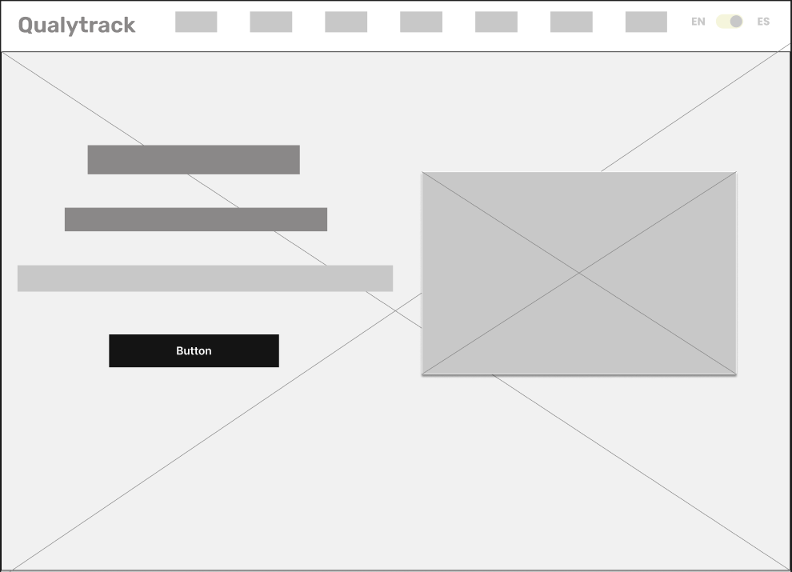

**Services**

Aquí se detallan los servicios principales de QualiTrack: Real-Time IoT Monitoring, Automated BPM Compliance, Immutable
Audit Trails y Digital Batch Management. Cada servicio se presenta con un icono representativo y una breve descripción,
haciendo que nuestra oferta sea fácil de entender y visualmente accesible.

Figura 173

Wireframe de servicios What We Offer

  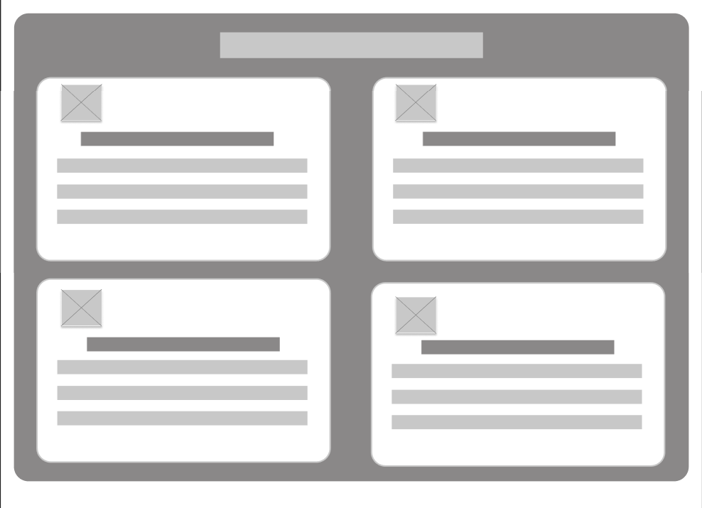

**Acerca de la aplicación (About the Platform):**

Esta sección presenta lo que hace única a QualiTrack: una plataforma para laboratorios farmacéuticos que automatiza el
control de calidad mediante integración IoT, elimina errores manuales y garantiza la trazabilidad inmutable. Destacamos
beneficios clave como captura automática de telemetría, alertas en tiempo real y cumplimiento nativo con normativas
DIGEMID.

Figura 174

Wireframe de beneficios (utilizado en About the Platform)

  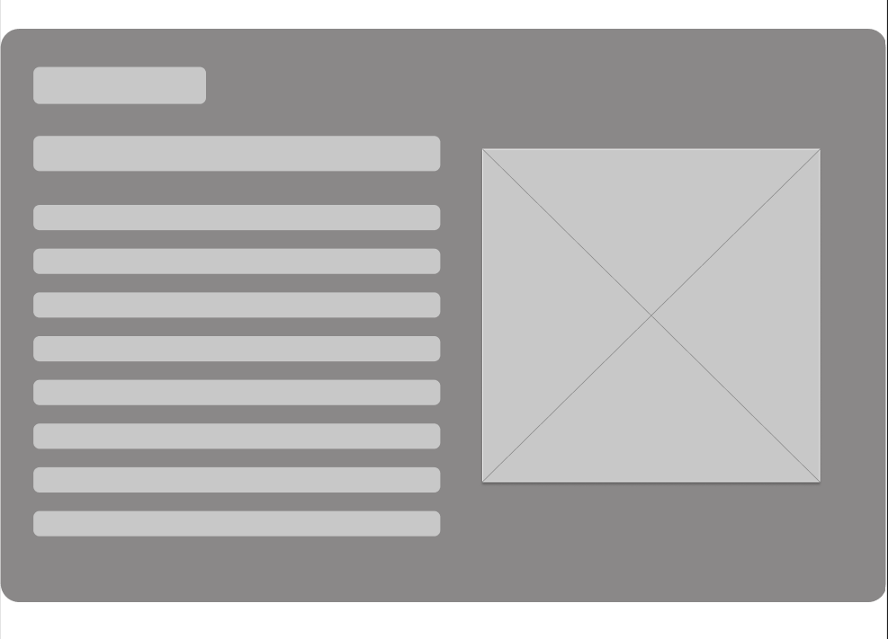

**Sobre el Equipo (Our Team):**

En esta sección, se humaniza la marca al presentar al equipo detrás de QualiTrack. Con fotos y descripciones de los
miembros, mostramos a las personas dedicadas a este proyecto, construyendo confianza y una conexión personal con los
visitantes.

Figura 175

Wireframede Our Team

  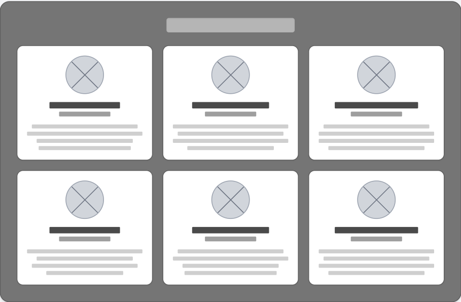

 

**Precios (Plans)**

La sección de Precios ofrece una visión clara de los planes disponibles. Presentamos el Standard Lab Plan y el
Enterprise Plan, con una comparativa de características para ayudar a los usuarios a elegir la opción que mejor se
adapte a sus necesidades, ya sea para un laboratorio mediano o para una institución de salud pública. Un selector entre
tarifas mensuales y anuales, junto con la indicación del ahorro asociado, facilita una elección más informada.

Figura 176

Wireframe de planes

  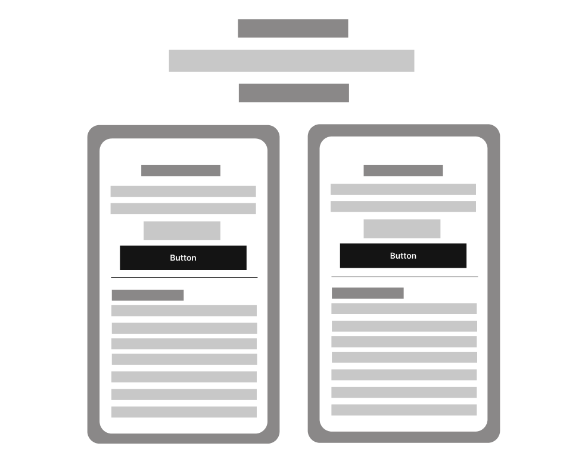

**Fotter**

El pie de página es un elemento crucial para la usabilidad. Contiene enlaces a información vital como "Terms of Service"
y "Privacy Policy", además de detalles de contacto (correo electrónico, teléfono y ubicación). Esto proporciona un
acceso rápido a la información sin saturar la interfaz, ofreciendo un cierre limpio y funcional a la página.

Figura 177

Wireframe del pie de página

  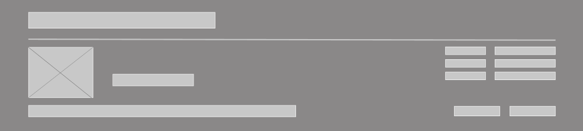

Este wireframe sienta las bases para un diseño visual que no solo se ve bien, sino que también guía al usuario de manera
intuitiva a través de nuestra propuesta de valor, reforzando la confianza y la conexión que QualiTrack promete.

### 5.3.2. Landing Page Mock-up

**Hero de la aplicación**

El hero de nuestra plataforma QualiTrack presenta una imagen principal que evoca precisión tecnológica y cumplimiento
normativo, con un título claro: 'The Future of Pharmaceutical Quality Management'. Una breve descripción capta nuestra
esencia de automatización y trazabilidad inmutable, y un botón de llamado a la acción 'Start now →' invita a los
usuarios a dar el primer paso hacia la digitalización de sus procesos de calidad. Una barra de navegación en la parte
superior permite acceder de forma fluida a todas las secciones de la página, proporcionando una experiencia de usuario
intuitiva.

Figura 178

Mock-up de Hero

  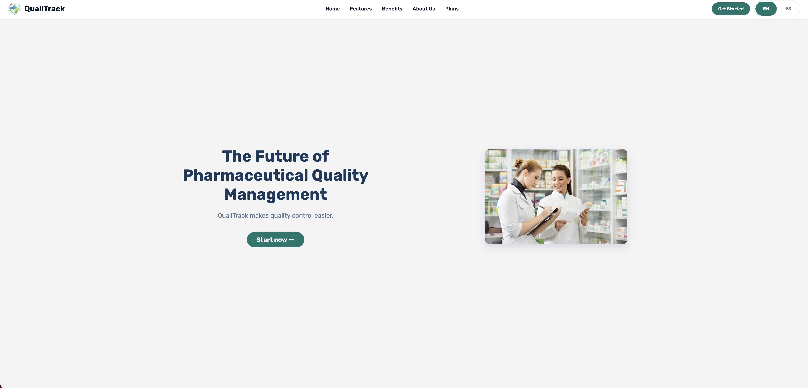

**What We Offer**

En la sección 'What We Offer', presentamos nuestras principales áreas de servicio a través de tarjetas con iconos
representativos. Cada tarjeta cuenta con un título y una breve descripción, como 'IoT Integration', 'Immutable
Traceability' o 'Regulatory Compliance', lo que permite a los usuarios entender rápidamente el alcance de nuestra
plataforma y los tipos de soluciones que ofrecemos para la gestión de calidad farmacéutica.

Figura 179

Mock-up de What We Offer

  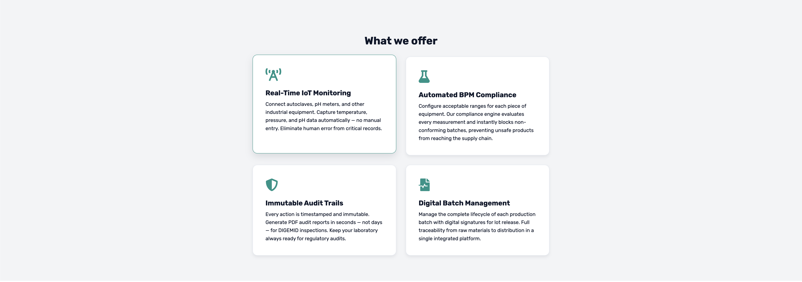

**Features**

La sección de "Features" muestra las funcionalidades clave de QualiTrack. El diseño tipo acordeón permite a los usuarios
expandir cada característica para leer su descripción completa, mientras que un video de demostración de YouTube al lado
les ofrece una vista visual de la plataforma en acción. Esto combina información detallada con un formato interactivo y
dinámico.

Figura 180

Mock-up de Features

  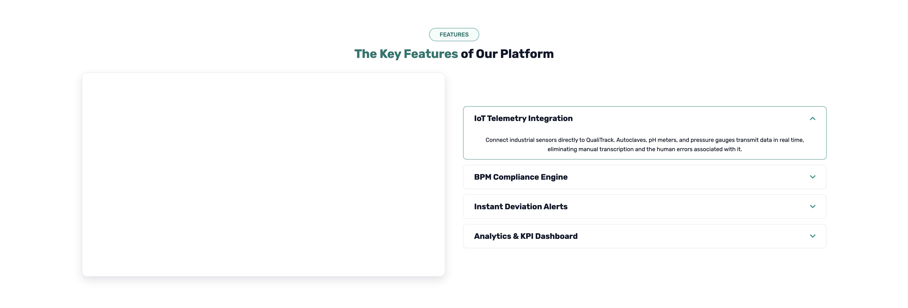

**Benefits**

En 'Benefits', destacamos las ventajas de utilizar QualiTrack. A través de un diseño de tarjetas con imágenes, títulos y
descripciones, comunicamos cómo nuestra plataforma elimina el error humano en registros críticos, agiliza la preparación
para auditorías regulatorias y aumenta la integridad y trazabilidad de los datos tanto para laboratorios farmacéuticos
como para entidades de salud pública.

Figura 181

Mock-up de Benefits

  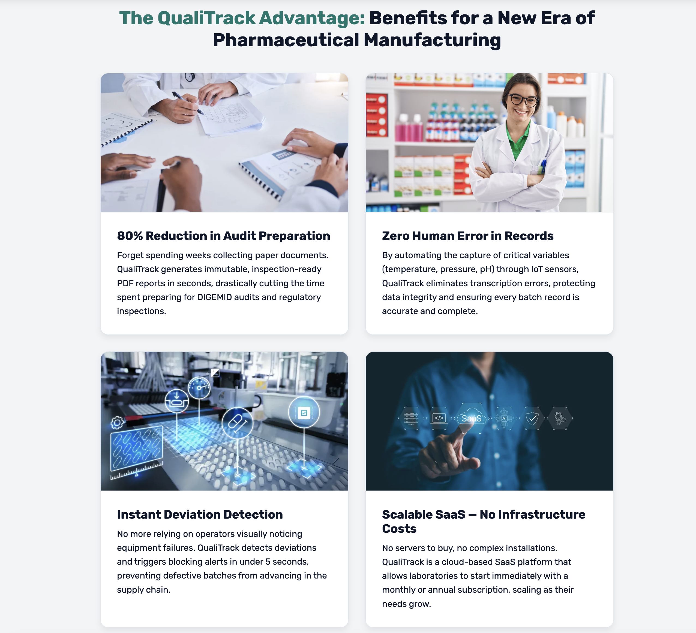

**About Us**

La sección 'About Us' presenta a QualiTrack. Aquí, compartimos nuestra misión de transformar la supervisión de procesos
farmacéuticos mediante la integración IoT y el cumplimiento normativo, así como los valores de innovación, transparencia
e integridad de datos que nos impulsan. Un video o imagen animada acompaña el texto, reforzando nuestro mensaje de una
manera visualmente atractiva y moderna.

Figura 182

Mock-up de About Us

  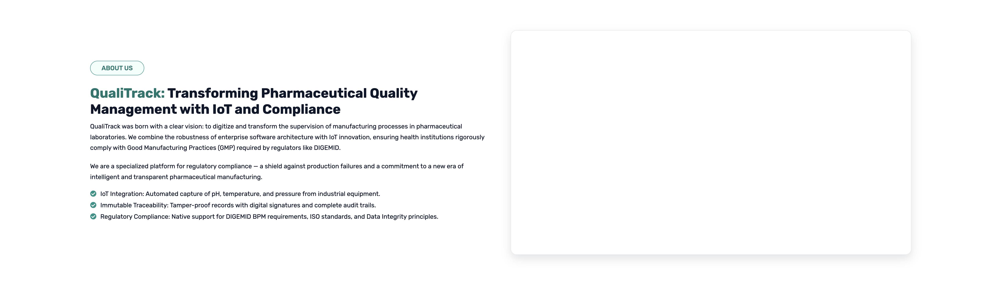

**Our Team**

La sección "Our Team" presenta a los ingenieros de software detrás de QualiTrack. Las tarjetas de perfil muestran una
foto, el nombre, el cargo y una breve biografía de cada miembro. El diseño de 3 tarjetas arriba y 2 abajo, centradas,
brinda un aspecto organizado y profesional, permitiendo a los usuarios conocer al equipo de desarrollo.

Figura 183

Mock-up de Our Team

  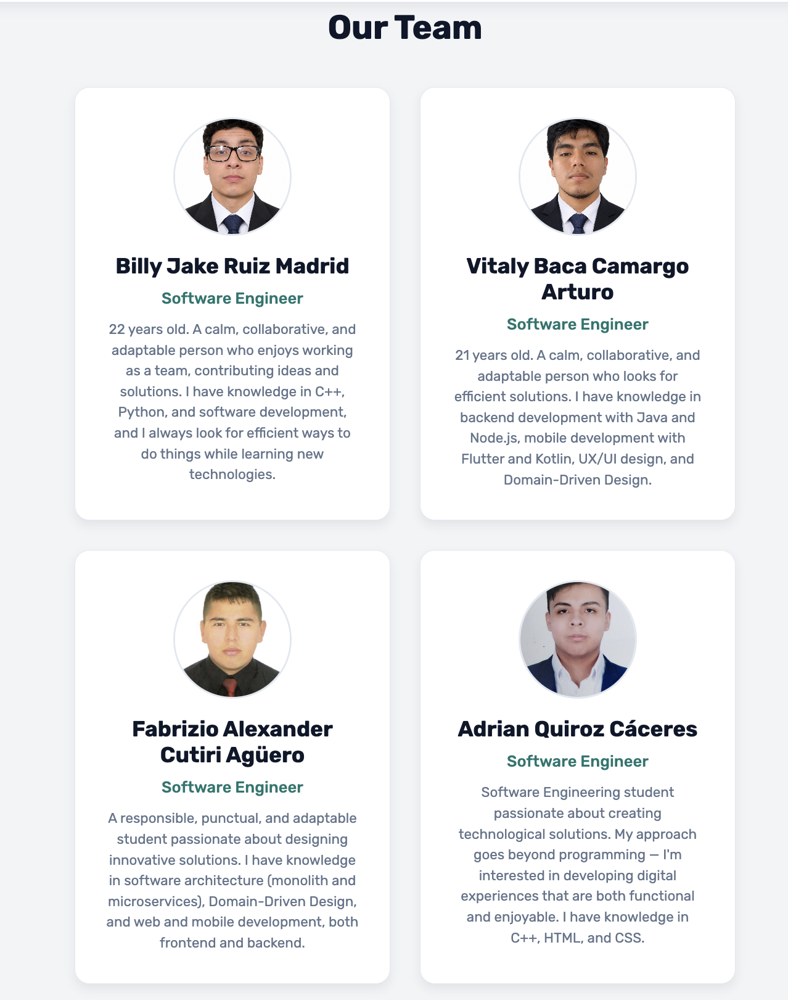
  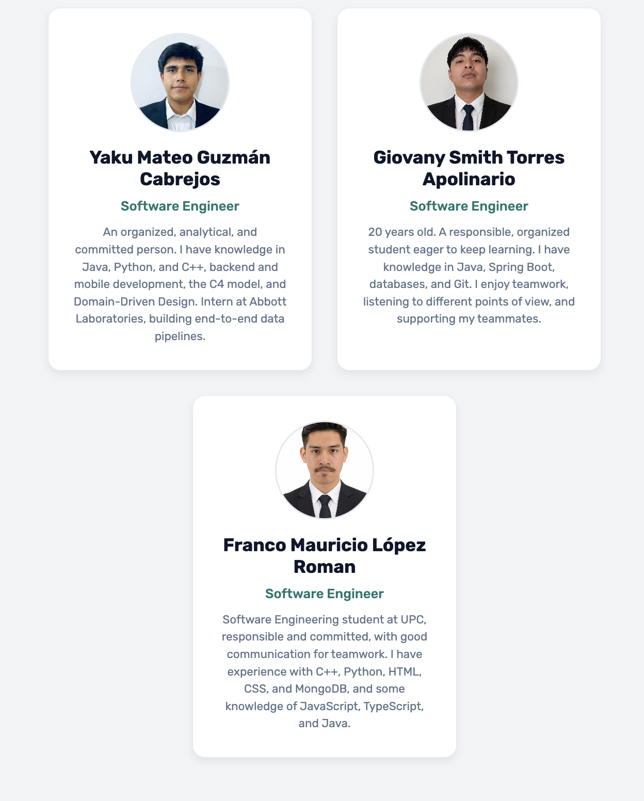

**Plans**

En la sección de "Plans", ofrecemos los detalles de nuestros planes de precios. Las tarjetas de "Standard Lab Plan" y
"Enterprise Home Plan" incluyen descripciones, precios con opciones mensuales y anuales, y listas de características. El
diseño permite un fácil cambio entre planes mensuales y anuales, facilitando la elección del plan adecuado.

Figura 184

Mock-up de Plans

  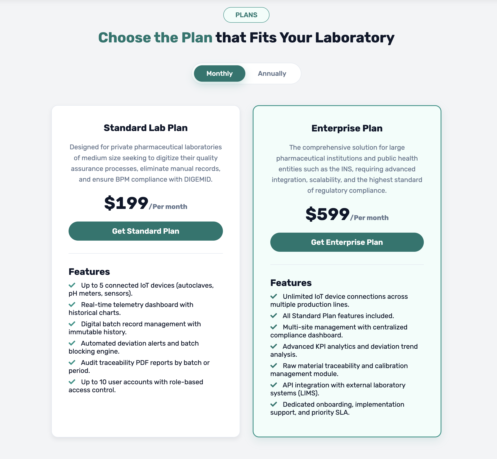

**Footer**

El "Footer" de nuestra landing page contiene enlaces útiles y recursos adicionales. Un formulario de suscripción invita
a los usuarios a unirse a nuestra comunidad. El logo de QualiTrack, enlaces de contacto, información legal y de derechos
de autor se encuentran aquí, asegurando que toda la información relevante esté fácilmente accesible para los usuarios.

Figura 185

Mock-up de Footer

  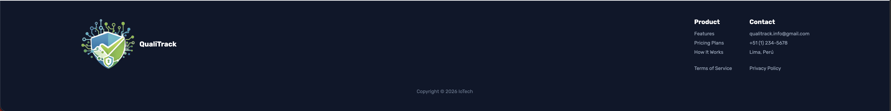

