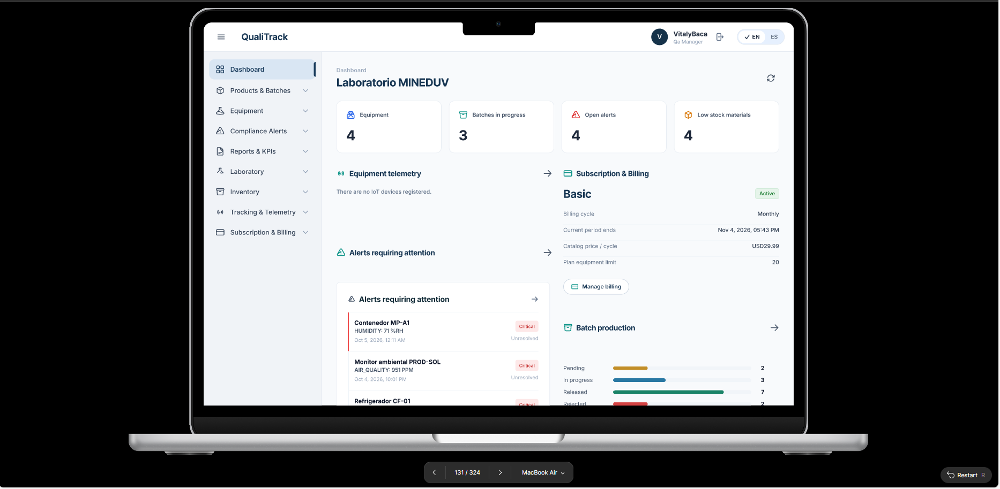
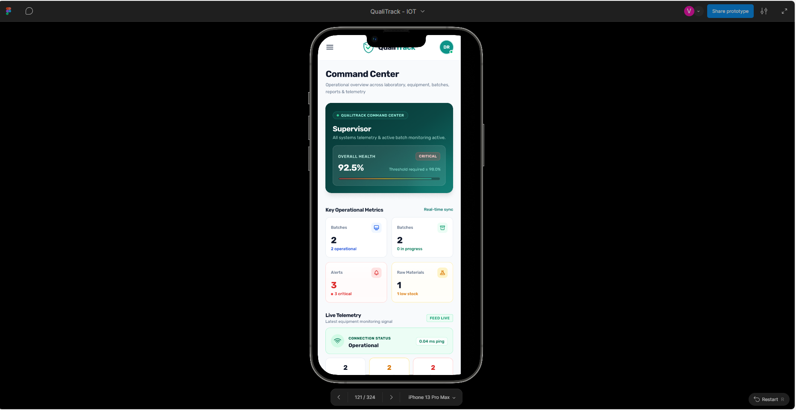

## 5.5. Applications Prototyping

En esta sección, se evidencian pruebas de uso del prototipo de la aplicación web y móvil. Además, se adjunta un video
donde se usa el prototipo y las interacciones con el prototipo se basan en los User Flows descritos previamente.

**Prototipo de la aplicación web**

Figura 305

Prototipo de la aplicación web

Link del video: https://bit.ly/4yGwGTr

**Prototipo de la aplicación movil**

Figura 306

Prototipo de la aplicación movil

Link del video: https://shorturl.at/pV2C9
