## 6.3. Validation Interviews

### 6.3.1. Diseño de Entrevista
Las entrevistas de validación con usuarios finales constituyen un instrumento clave para recoger retroalimentación sobre la solución propuesta. Estas entrevistas fueron diseñadas con el objetivo de evaluar el grado de adecuación de QualiTrack frente a las necesidades de los usuarios, identificar limitaciones de usabilidad y reconocer oportunidades de mejora para futuras iteraciones del producto.

Se realizaron entrevistas con representantes de los segmentos objetivo del proyecto: gerentes y jefes de aseguramiento de calidad, así como operadores de laboratorio. Esta selección permitió obtener una perspectiva complementaria entre quienes supervisan la calidad y cumplimiento de procesos, y quienes ejecutan actividades operativas dentro del laboratorio.

#### Segmento 1: Responsables de calidad y supervisión

##### A1. Comprensión de los dispositivos

1. Con sus palabras, ¿Qué hace el Monitor de Ambiente y qué hace el Monitor de Contenedor? ¿En qué se diferencian?
2. ¿En qué ambientes de su laboratorio o almacén instalaría cada uno y por qué?
3. Viendo el diseño, ¿Qué dudas le surgen sobre precisión, calibración, mantenimiento o instalación?
4. Se plantea que el contenedor actúe solo (ventilador, enfriamiento, compuerta) cuando algo sale de rango. ¿En qué casos lo aceptaría y en cuáles querría aprobarlo antes?
5. ¿Qué tipo de lotes, materias primas o productos guardaría en el contenedor?
6. El tamaño 110 × 110 mm del  Monitor de Ambiente para su instalación en pared o techo, ¿le parecen adecuados para su ambiente?
7. ¿Hay alguna acción automática con la que no se sentiría cómodo? ¿Cuál y por qué?
8. ¿Qué tan cómodo se sentiría trabajando cerca de este dispositivo todo el día?

##### A2. Aplicación web

9. Al ver el Dashboard, ¿Qué cree que puede consultar aquí? ¿Qué es lo primero que mira?
10. Al ver el Dashboard, ¿Qué indican los cuatro cuadros de informacion (equipos, lotes en proceso, alertas abiertas, materiales con stock bajo)? ¿Alguno no lo entiende? 
11. Al ver el Dashboard, ¿Podría saber en pocos segundos si su laboratorio está bien o necesita acción? ¿Qué parte se lo dice?
12. Al ver el Dashboard, Qué le sobra y qué le falta en este panel?
13.  Al ver el Dashboard, ¿Qué tan seguro se sentiría de empezar su turno revisando solo esta pantalla sin que se le escape algo importante?
14. En la vista d Perfiles ambientales ¿Qué tan seguro se sentiría configurando usted mismo los rangos de un contenedor o del medidor ambiental?
17. En el Resumen Ambiental ¿Prefiere ver las tarjetas o la tabla? ¿Cuándo usaría cada una?
18. En el Resumen Ambiental ¿Le sirve el promedio de 31 días o preferiría ver los picos? ¿Qué decisión tomaría con esta pantalla?
19. Mirando el gráfico de Desviaciones con las zonas verde, amarilla y roja. ¿Se entiende sin explicación?
20. Mirando los Indicadores de desviación ¿Qué tan seguro se sentiría de tomar una decisión con esta información?
21. De acuerdo con el Generador de Reportes y Documentos ¿Qué tipo de reporte usaría más y presentaría en las auditorias?
22. Genere un reporte de auditoría. ¿Incluye lo que le piden o que información nueva agregaría para reemplazar sus formatos físicos o archivos Excel?
23. Comparada con cómo trabaja hoy (formatos físicos, Excel), ¿Qué le ahorraría más tiempo? ¿Hay algo que le daría más trabajo?
24. En la vista de Alertas ¿Le falta algún dato que usted necesitaría saber de una alerta pasada?
25. En algunas alertas, el propio equipo corrigió el problema solo. ¿Qué opina de eso?
26. Si un auditor le pidiera ver las alertas de los últimos 3 meses, ¿se sentiría seguro mostrándole esta pantalla? ¿Por qué?

##### A3. Aplicación móvil

27. Al ver el Inicio, ¿Qué haría con esta información al empezar su turno o cuando no está en el laboratorio? ¿Qué decisión tomaría a partir de ella?
28. Imagine que está fuera del laboratorio y llega una notificación de alerta crítica. ¿Qué haría desde que la ve hasta que la deja controlada?
29. Hoy, ¿Cómo se entera de que algo salió de rango cuando no está en el área? ¿Esta app reemplazaría esa forma? ¿Qué le faltaría?
30. En el Detalle de una alerta, ¿Qué información necesitaría para decidir qué hacer? ¿Cuál de ellas es la que más usaría?
31. Cuando la alerta ya se normalizó, ¿Cómo decide hoy si cerrarla? ¿Qué necesitaría revisar antes de marcarla como resuelta desde el celular?
32. ¿A quién avisaría o qué tarea le asignaría después de recibir una alerta? ¿Lo haría desde la app o por otro medio?
33. Imagine que un auditor le pregunta por un lote ya liberado. ¿Usaría la app para responderle? ¿Qué le mostraría y qué le faltaría?
34. Si un material llega a stock bajo o se vence, ¿Qué haría con ese aviso? ¿Quién actuaría?
35. Al revisar un lote, ¿Qué tendría que ver para sentirse seguro de liberarlo o rechazarlo? ¿Lo haría desde el celular o esperaría a la computadora?

##### A4. Preguntas Finales
36. ¿En qué momentos de su día usaría el celular para esto y en cuáles preferiría la computadora?
37. ¿Qué es lo que más le gustó y qué cambiaría primero en ambas aplicaciones tanto web como móvil?
38. ¿Qué tan seguro se sentiría usando estas aplicación todos los días sin capacitación larga?
39. ¿Qué aspectos le generarían desconfianza al usar una de estas plataformas digitales?
40. Pensando en los dos dispositivos (el Monitor de Ambiente y el Monitor de Contenedor) junto con las aplicaciones, ¿qué problema de su trabajo de hoy resolverían y cuál no?
41. ¿Qué tendría que pasar o ver para confiar en las lecturas de los dispositivos y reemplazar sus registros manuales?
42. Si tuviera que decidir hoy, ¿en qué áreas de su laboratorio o almacén instalaría primero estos dispositivos y por qué?
43. ¿Qué le haría dudar o desistir de instalarlos en su laboratorio (costo, mantenimiento, validación BPM, tiempo de instalación)?
44. Para terminar, de todo lo que vio hoy, los dispositivos y las aplicaciones, ¿qué es lo más valioso para su trabajo y qué es lo que más le falta?
    
#### Segmento 2: Personal operativo de laboratorios y almacenes

##### B1. Comprensión de los dispositivos

1. Con sus palabras, ¿Qué hace el Monitor de Ambiente y qué hace el Monitor de Contenedor? ¿En qué se diferencian?
2. ¿Qué opina del Monitor de Ambiente? ¿Le parece útil para controlar las condiciones de su área de trabajo? ¿Por qué?
3. ¿Qué opina del Monitor de Contenedor? ¿Le parece útil para conservar materias primas o lotes en su almacén? ¿Por qué?
4. Viendo el diseño, ¿Qué le parecen el tamaño y la forma de cada dispositivo para el espacio donde trabaja? ¿Cambiaría algo?
5. Viendo el diseño del Monitor de Contenedor, ¿Le parece práctico de cargar, abrir y limpiar en su día a día? ¿Qué mejoraría?
6. ¿Qué opina de que el Monitor de Contenedor actúe solo (ventilador, enfriamiento, compuerta) cuando algo sale de rango? ¿Le daría tranquilidad o preferiría que alguien lo apruebe antes?
7. ¿Qué tanta confianza le darían las lecturas de cada dispositivo frente a los termohigrómetros o registros que usa hoy? ¿Qué le haría dudar?
8. ¿Qué tan cómodo se sentiría trabajando cerca de estos dispositivos todo el día? ¿Alguno le parece innecesario o le gustaría que hiciera algo más?

##### B2. Aplicación web

9. Al ver el Dashboard al empezar su turno, ¿Qué información le sirve para organizar su trabajo del día? ¿Qué es lo primero que mira?
10. Al ver el Dashboard, ¿Podría saber en pocos segundos qué pendientes requieren su atención? ¿Qué parte se lo dice?
11. En Inventario, al registrar una nueva recepción de materia prima, ¿Los datos que pide son los mismos que usted anota hoy al recibir un material? ¿Qué le sobra y qué le falta?
12. En Inventario, la recepción queda en cuarentena hasta su revisión de calidad. ¿Le ayuda a saber qué materiales puede usar y cuáles todavía no?
13. En Inventario, al ver "Próximos a vencer" y los materiales con stock bajo, ¿Qué haría con esa información? ¿Le ayudaría a anticiparse antes de que falte un material?
14. Al guardar un lote de materia prima en un contenedor, ¿Le sirve saber en qué contenedor está y en qué condiciones se conserva? ¿Cómo lo controla hoy?
15. En Lotes de producción, al registrar el uso de materia prima, ¿El proceso sigue el orden en que usted trabaja en planta? ¿En qué momento lo registraría?
16. Al registrar un consumo, la aplicación descuenta el stock y solo permite usar recepciones liberadas. ¿Le da seguridad de no usar un material equivocado o sin stock?
17. En el Detalle del lote, al registrar el equipo y el personal que participaron, ¿Reemplazaría lo que anota hoy en el registro de lote o en sus formatos? ¿Qué le faltaría?
18. En la Trazabilidad del lote, si su jefe o un auditor le preguntara qué materiales, equipos y personas intervinieron, ¿Podría responderle rápidamente con esta pantalla?
19. En Monitoreo ambiental, ¿Podría saber en pocos segundos si su área está dentro de rango antes de empezar a trabajar? ¿Qué dato mira primero?
20. En Historial de telemetría, ¿En qué situación de su trabajo consultaría las lecturas pasadas de un dispositivo? ¿Reemplazaría su registro manual de temperatura y humedad?
21. En la vista de Alertas, ¿Le queda claro qué alertas debe atender usted y cuáles ya está atendiendo un compañero?
22. Al resolver una alerta, ¿Las acciones correctivas que propone la aplicación coinciden con lo que hace hoy ante una desviación? ¿Qué le faltaría registrar?
23. En el Detalle de un equipo, ¿Le sirve revisar su estado y su historial de mantenimiento y calibración antes de usarlo? ¿Cómo lo verifica hoy?
24. Comparada con cómo trabaja hoy (cuadernos, formatos físicos, Excel), ¿Qué le ahorraría más tiempo? ¿Hay algo que le daría más trabajo?

##### B3. Aplicación móvil

25. Al ver el Inicio, ¿Qué haría con esta información al empezar su turno o cuando está fuera de su área? ¿Qué decisión tomaría a partir de ella?
26. Imagine que está en planta y llega una notificación de alerta. ¿Qué haría desde que la ve hasta que la deja controlada? ¿La app le ayuda en cada paso?
27. Hoy, ¿Cómo se entera de que algo salió de rango en su área? ¿Esta app reemplazaría esa forma? ¿Qué le faltaría?
28. En el Detalle de una alerta, ¿Tiene la información que necesita para actuar (qué salió de rango, dónde, desde cuándo y qué hizo el equipo)? ¿Cuál es la que más usaría?
29. Al reconocer o resolver una alerta desde el celular, ¿Le resulta práctico hacerlo en su área de trabajo o preferiría hacerlo en la computadora?
30. En Inventario, al consultar una materia prima, ¿Le serviría revisar sus lotes, vencimientos y movimientos frente al anaquel? ¿Qué le faltaría?
31. En el Detalle de un lote, ¿El historial le permite saber qué se hizo, quién lo hizo y cuándo? ¿Lo consultaría durante la producción?
32. En Telemetría, ¿Le sirve ver las lecturas en vivo desde el celular mientras trabaja? ¿En qué momentos las revisaría?
33. En el Detalle de un equipo, ¿Le sirve saber si está conectado y cuándo fue su último mantenimiento antes de usarlo?
34. ¿Puede usar el celular dentro de su área de trabajo (zonas limpias, guantes, equipo de protección)? ¿Esto cambiaría la forma en que usaría la app?

##### B4. Preguntas Finales

35. ¿En qué momentos de su turno usaría el celular y en cuáles preferiría la computadora?
36. ¿Qué es lo que más le gustó y qué cambiaría primero en ambas aplicaciones, tanto web como móvil?
37. ¿Qué tan seguro se sentiría usando estas aplicaciones todos los días sin una capacitación larga?
38. ¿Qué aspectos le generarían desconfianza al registrar su trabajo en estas plataformas digitales?
39. ¿Qué registros manuales de su día dejaría de llenar si usara estas aplicaciones? ¿Cuáles seguiría necesitando?
40. ¿Qué tarea de su trabajo diario no encontró en las aplicaciones y le gustaría poder hacer?
41. Para terminar, de todo lo que vio hoy, ¿Qué es lo que más le ayudaría en su trabajo diario y qué es lo que más le falta?

### 6.3.2 Registro de Entrevista

A continuación, se presenta el registro correspondiente a las entrevistas realizadas con representantes de los segmentos de responsables de calidad y personal operativo quienes participaron en la validación de la aplicación web, aplicación móvil y dispositivo de la plataforma Qualitrack. El objetivo fue evaluar la claridad del mensaje, la propuesta de valor y la percepción de utilidad de la propuesta desde la perspectiva los segmentos responsables de calidad y personal operativo de los laboratorios.

#### Segmento 1: Responsables de calidad y supervisión

<table>
    <colgroup></colgroup>
    <thead>
        <tr>
            <th colspan="2">Entrevista #1 </th>
        </tr>
    </thead>
    <tbody>
        <tr>
            <td>Nombre</td>
            <td>Ricardo</td>
        </tr>
        <tr>
            <td>Apellidos</td>
            <td>Melendrez</td>
        </tr>
        <tr>
            <td>Edad</td>
            <td>33 años</td>
        </tr>
        <tr>
            <td>Ubicacion</td>
            <td>Chilca - Cañete</td>
        </tr>
         <tr>
            <td>Fecha de entrevista</td>
            <td>14 de noviembre de 2026</td>
        </tr>
        <tr>
            <td>Evidencia</td>
            <td style="text-align: left;">
                

            </td>
        </tr>
        <tr>
            <td>Link</td>
            <td>
            <a href="https://shorturl.at/Nt7Pn" target="_blank">
                https://shorturl.at/Nt7Pn
            </a>
            </td>
        </tr>
        <tr>
            <td>Timing donde inicia la entrevista </td>
            <td>0:00 min</td>
        </tr>
        <tr>
            <td>Duración de la entrevista </td>
            <td>5:00 min</td>
        </tr>
        <tr>
            <td>Resumen</td>
            <td>
                Durante la sesión, se presentaron los componentes principales de la solución IoTech a Ricardo Meléndrez, analista de control de calidad de productos farmacéuticos que trabaja en el área de estabilidades de un laboratorio, para evaluar su percepción sobre los dispositivos de monitoreo (Monitor de Ambiente y Monitor de Contenedor) y sus plataformas web y móvil. En su trabajo supervisa principalmente las condiciones de temperatura y humedad en áreas como físico-químico, pesaje e instrumentación, donde los valores deben mantenerse dentro de los parámetros establecidos para evitar alteraciones en los análisis. La entrevista, dirigida por [nombre del entrevistador], tuvo como objetivo validar la experiencia de usuario, la percepción de valor de las funcionalidades y la facilidad de uso de la plataforma.

En la evaluación de los dispositivos, el entrevistado entendió el contenedor como un equipo que crea y conserva un ambiente de temperatura y humedad, y lo ubicó en zonas aisladas de almacenaje, de poco tránsito y con acceso esporádico. Su principal inquietud fue la capacidad: indicó que en la industria farmacéutica los volúmenes son grandes (aproximadamente 100 frascos de 100 ml por lote, o entre 10 y 30 frascos en presentaciones de medio litro o un litro) y que el registro ante DIGEMID exige como mínimo 3 lotes. Consideró que las dimensiones presentadas no serían las adecuadas y preguntó por la capacidad interna frente a la externa, aunque reconoció que farmacéuticas pequeñas podrían manejar cantidades menores. No manifestó incomodidad con ninguna acción automática de los devices.

Respecto a la plataforma web, valoró el dashboard como una pantalla que permite saber en pocos segundos si el laboratorio está bien, gracias al gráfico y a las alertas, y se sintió bastante seguro de iniciar su turno revisando solo esa vista. Comprendió los cuatro cuadros de resumen después de la presentación. Como mejora, sugirió diferenciar por colores (amarillo o rojo) en el gráfico cuando la temperatura se acerque al límite o salga de especificación. Prefirió las tarjetas del Resumen Ambiental frente a la tabla y el gráfico de picos frente al promedio de 31 días, para identificar la fecha exacta en que salió de especificación. El gráfico de desviaciones se entendió sin explicación y le generó mucha seguridad para tomar decisiones. Además, se sintió seguro configurando por sí mismo los perfiles ambientales.

En el generador de reportes, indicó que usaría el reporte ambiental y de inventario en formato PDF, con periodicidad semanal o quincenal, y sugirió incluir un gráfico de picos. Consideró que la plataforma ahorraría tiempo frente a sus formatos físicos y archivos Excel, tanto por la descarga de reportes como por su carácter visual. El historial de alertas le pareció completo y valoró de forma positiva que algunos equipos corrijan el problema de forma autónoma. Ante una auditoría, se sentiría seguro y presentaría el reporte PDF impreso, para evitar que el auditor ingrese a la plataforma y solicite información de otros equipos o fechas.

La respuesta hacia la versión móvil fue favorable. Destacó que el inicio le brinda información sobre alertas y dispositivos en línea, lo que le permite saber si un contenedor o cabina está fuera de especificación y avisar a mantenimiento. Indicó que reemplazaría su método actual, que depende de una pantalla fija en el trabajo, y que no necesita más información en el detalle de una alerta, pues usaría principalmente las críticas abiertas. Para marcar una alerta como resuelta, requeriría una revisión física del contenedor. Ante un lote ya liberado o una auditoría, usaría solo los reportes en PDF, y para liberar o rechazar un lote solo necesitaría verificar que la temperatura y la humedad no hayan salido de especificación durante todo el periodo de almacenamiento. En cuanto al uso, empleará la computadora en horario laboral y el celular fuera de él, para monitorear cada cierto tiempo.

Finalmente, el entrevistado destacó como lo más gustado el carácter visual, gráfico e intuitivo de ambas plataformas. Se sentiría seguro usándolas todos los días sin una capacitación larga y no manifestó desconfianza. Para confiar en las lecturas y reemplazar sus registros manuales, sugirió realizar demos de la plataforma durante un tiempo. Señaló que instalaría los dispositivos primero en el almacén y en las cabinas de estabilidades por ser áreas críticas, y que la única barrera posible sería el costo. Se confirmó que el mayor valor percibido de la solución es tener la información a la mano y de manera rápida para tomar decisiones. La validación de las dimensiones y capacidad del contenedor, la incorporación de alertas por color y del gráfico de picos en los reportes, y la confirmación física para el cierre de alertas se identificaron como las principales oportunidades para fortalecer la solución.
            </td>
        </tr>
    </tbody>
</table>

#### Segmento 2: Personal operativo de laboratorios y almacenes

### 6.3.3 Evaluaciones según Heuristica

#### 6.3.3.1. Evaluación a la aplicación web

  <h2>UX Heuristics & Principles Evaluation</h2>
  <h3>Usability – Inclusive Design – Information Architecture</h3>

<strong>CARRERA:</strong> Ingeniería de Software

<strong>CURSO:</strong> Desarrollo de soluciones IoT

<strong>PROFESOR:</strong> Ángel Augusto Velasquez Nuñez

<strong>AUDITOR:</strong> Equipo Qualitrack

<strong>PRODUCTO EVALUADO:</strong> QualiTrack Web Application

<strong>CLIENTE(S):</strong> Responsables de control de calidad y Técnicos de laboratorio

#### SITE o APP A EVALUAR

Qualitrack Web Application

#### TAREAS A EVALUAR

El alcance de esta evaluación incluye la revisión de la usabilidad de las siguientes tareas:

1. Registro de cuenta e inicio de sesión
2. Onboarding: cambio de la contraseña temporal y creación del laboratorio
3. Registro de personal del laboratorio
4. Registro de un equipo y de un dispositivo IoT
5. Configuración de los parámetros BPM de un equipo
6. Registro de una materia prima
7. Registro de un producto y creación de un lote
8. Liberación o rechazo de un lote
9. Atención y resolución de una alerta de desviación
10. Generación de un reporte

No están incluidas en esta versión de la evaluación las siguientes tareas:

1. Pago de una suscripción en Stripe (formulario de pago, página de éxito y de cancelación)
2. Cancelación de la suscripción y consulta del resumen de facturación
3. Monitoreo ambiental en vivo y consulta del historial de telemetría
4. Acceso a las rutas heredadas (legacy) que solo redirigen a otras vistas
5. Consulta del perfil y de la actividad de otro miembro del personal
6. Importación de registros de pre-inventario y asignación de contenedores

#### ESCALA DE SEVERIDAD

Los errores serán puntuados tomando en cuenta la siguiente escala de severidad:

| Nivel | Descripción                                                                                                                                                       |
| :---: | :---------------------------------------------------------------------------------------------------------------------------------------------------------------- |
|   1   | **Problema superficial:** puede ser superado fácilmente por el usuario u ocurre con muy poca frecuencia. No necesita corregirse salvo que haya tiempo disponible. |
|   2   | **Problema menor:** ocurre un poco más seguido o es algo más difícil de superar. Se le asigna prioridad baja para el siguiente release.                           |
|   3   | **Problema mayor:** ocurre con frecuencia o el usuario no logra resolverlo. Es importante corregirlo; se le asigna prioridad alta.                                |
|   4   | **Problema muy grave:** error de gran impacto que impide al usuario continuar usando la herramienta. Es imperativo corregirlo antes del lanzamiento.              |

#### TABLA RESUMEN

| #   | Problema | Escala de severidad | Heurística/Principio violada(o) |
| :-: | -------- | :-----------------: | ------------------------------- |
| 1 | No existe una acción para crear un lote desde la vista de lotes de producción | 3 | Information Architecture: Is it findable? / Usability: Flexibilidad y eficiencia en el uso |
| 2 | Los formularios de liberación y rechazo no muestran los datos del lote sobre el que se decide | 3 | Usability: Reconocer antes que recordar / Prevención de errores |
| 3 | El nombre y la unidad de un parámetro BPM se ingresan como texto libre | 3 | Usability: Prevención de errores |
| 4 | Los parámetros BPM registrados no muestran acciones para editarlos o eliminarlos | 3 | Usability: Libertad y control por parte del usuario |
| 5 | El botón para agregar un parámetro BPM está rotulado como "Parameter Name" | 2 | Usability: Consistencia y estándares / Information Architecture: Is it communicative? |
| 6 | Las acciones de registro usan nombres distintos en cada módulo | 2 | Usability: Consistencia y estándares |
| 7 | Los botones deshabilitados no indican qué falta para poder continuar | 2 | Usability: Visibilidad del estado del sistema |
| 8 | El registro de dispositivo IoT no valida el formato de la dirección MAC y usa términos técnicos internos | 2 | Usability: Prevención de errores / Relación entre el sistema y el mundo real |
| 9 | El ambiente del equipo no se pide al registrarlo y el selector aparece vacío en el detalle | 2 | Usability: Reconocer antes que recordar |
| 10 | El inventario no explica la diferencia entre "Usable stock" y "Physical balance" | 2 | Information Architecture: Is it clear? / Usability: Ayuda y documentación |
| 11 | La tabla de personal queda cortada y la acción de desactivar es un ícono sin texto | 2 | Information Architecture: Is it accessible? / Usability: Flexibilidad y eficiencia en el uso |
| 12 | El dashboard muestra un límite de equipos del plan menor que los equipos registrados | 2 | Information Architecture: Is it credible? |
| 13 | El menú lateral tapa el borde izquierdo del contenido al abrir una pantalla directamente | 2 | Usability: Diseño estético y minimalista / Information Architecture: Is it accessible? |
| 14 | El texto de ayuda del número de lote se superpone con la etiqueta "Quantity" | 1 | Usability: Diseño estético y minimalista |

#### DESCRIPCIÓN DE PROBLEMAS

**PROBLEMA #1:** No existe una acción para crear un lote desde la vista de lotes de producción

**Severidad:** 3

**Heurística violada:** Information Architecture: Is it findable? / Usability: Flexibilidad y eficiencia en el uso

**Problema:**

La vista *Production Batches* lista, filtra y pagina los lotes, pero no ofrece ningún botón para crear uno. El único botón principal lleva a *Pharmaceutical products*; para crear un lote el usuario debe ir al catálogo de productos, elegir el ambiente, abrir el producto y recién ahí pulsar *New Batch*. Quien entra a la vista de lotes con la intención de registrar un lote no encuentra la acción donde la espera.

  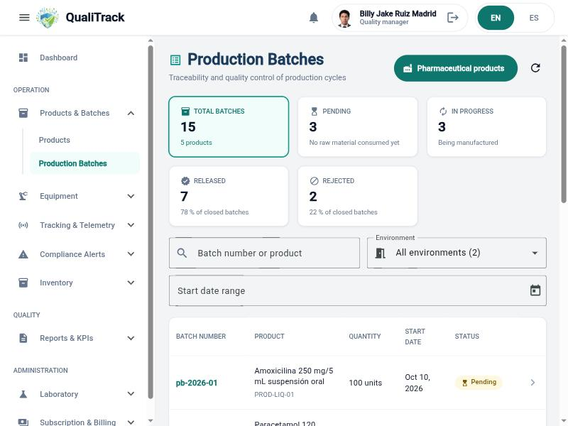

**Recomendación:**

Agregar un botón *New Batch* en la cabecera de *Production Batches* que permita elegir el producto dentro del mismo formulario, manteniendo el acceso actual desde el detalle del producto.

**PROBLEMA #2:** Los formularios de liberación y rechazo no muestran los datos del lote sobre el que se decide

**Severidad:** 3

**Heurística violada:** Usability: Reconocer antes que recordar / Prevención de errores

**Problema:**

Al pulsar *Release Batch* o *Reject Batch* se abre una pantalla aparte que solo contiene la fecha y un campo de notas. No se muestra el número de lote, el producto, la cantidad ni las especificaciones de calidad, y el enlace de retorno dice únicamente *Batch Detail*. La liberación es una decisión firmada e irreversible ("the batch can no longer be modified"), por lo que el responsable de calidad debe recordar de memoria qué lote estaba revisando. En el formulario de rechazo, además, no se advierte que la acción sea definitiva.

  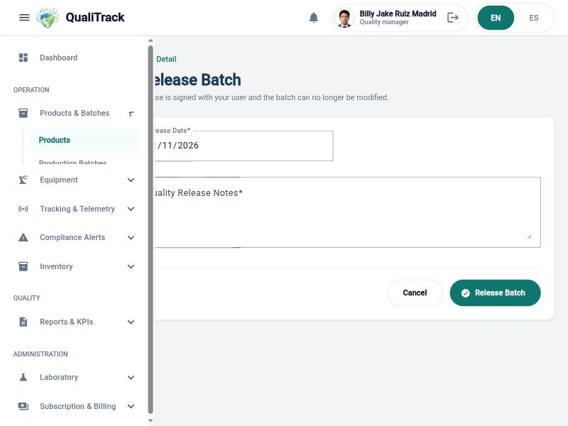

**Recomendación:**

Mostrar en ambos formularios un resumen del lote (número, producto, cantidad, ambiente y especificaciones BPM) y pedir una confirmación explícita que repita el número de lote antes de registrar la decisión. Indicar también en el rechazo que la acción no se puede deshacer.

**PROBLEMA #3:** El nombre y la unidad de un parámetro BPM se ingresan como texto libre

**Severidad:** 3

**Heurística violada:** Usability: Prevención de errores

**Problema:**

En *BPM Parameter Config* los campos *Parameter Name* y *Unit* son cajas de texto sin lista de opciones, sugerencias ni ejemplos. El usuario puede escribir "Temperatura", "Temperature" o "Temp." y "°C" o "C" para la misma variable, lo que genera parámetros que no coinciden con las variables que reporta la telemetría. La pantalla tampoco indica a qué equipo pertenece el parámetro que se está creando.

  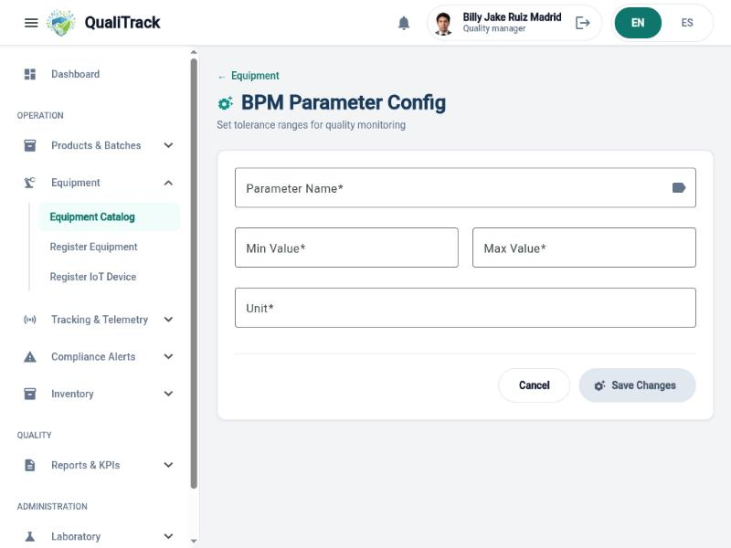

**Recomendación:**

Reemplazar el nombre por una lista de las variables que el sistema monitorea (temperatura, humedad, presión, calidad de aire) y autocompletar la unidad según la variable elegida. Mostrar el nombre del equipo en el encabezado del formulario y validar que el mínimo sea menor que el máximo.

**PROBLEMA #4:** Los parámetros BPM registrados no muestran acciones para editarlos o eliminarlos

**Severidad:** 3

**Heurística violada:** Usability: Libertad y control por parte del usuario

**Problema:**

La pestaña *BPM Config* del equipo lista cada parámetro con su rango (por ejemplo "Temperatura 121 - 134 °C"), pero las filas no presentan ninguna acción visible para corregir un rango mal ingresado ni para retirar un parámetro. Si el usuario se equivoca al registrar un límite, no tiene una salida evidente para deshacer el error.

  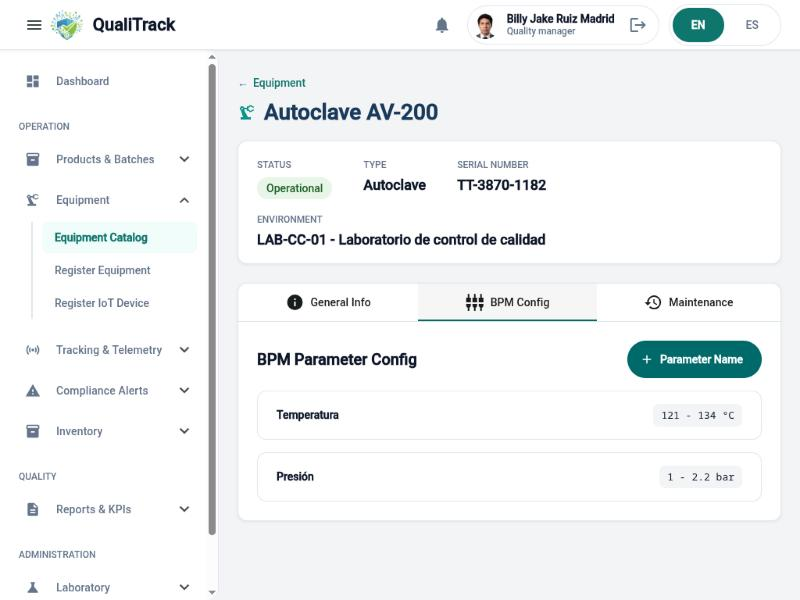

**Recomendación:**

Agregar en cada fila las acciones *Editar* y *Eliminar* (esta última con confirmación), y registrar el cambio en el historial del equipo.

**PROBLEMA #5:** El botón para agregar un parámetro BPM está rotulado como "Parameter Name"

**Severidad:** 2

**Heurística violada:** Usability: Consistencia y estándares / Information Architecture: Is it communicative?

**Problema:**

En la pestaña *BPM Config* el botón principal muestra el texto "+ Parameter Name", que es la etiqueta de un campo y no una acción. El usuario debe deducir por el ícono "+" que ese botón sirve para agregar un parámetro.

  

**Recomendación:**

Cambiar el rótulo a "Add parameter" / "Agregar parámetro", siguiendo el patrón verbo + objeto que usan los demás botones de la aplicación.

**PROBLEMA #6:** Las acciones de registro usan nombres distintos en cada módulo

**Severidad:** 2

**Heurística violada:** Usability: Consistencia y estándares

**Problema:**

La misma acción de crear un registro recibe rótulos diferentes según la pantalla: *Save Changes* al crear un equipo o un parámetro BPM (aunque no se está modificando nada), *Save* en materia prima, *Register* en producto, lote y personal, y *Register device* en dispositivo IoT. Ocurre lo mismo entre el menú y las pantallas: el menú dice *Register Equipment* y la pantalla se titula *New Equipment*; el menú dice *Register Staff Member* y el botón de la lista dice *Add Staff*.

  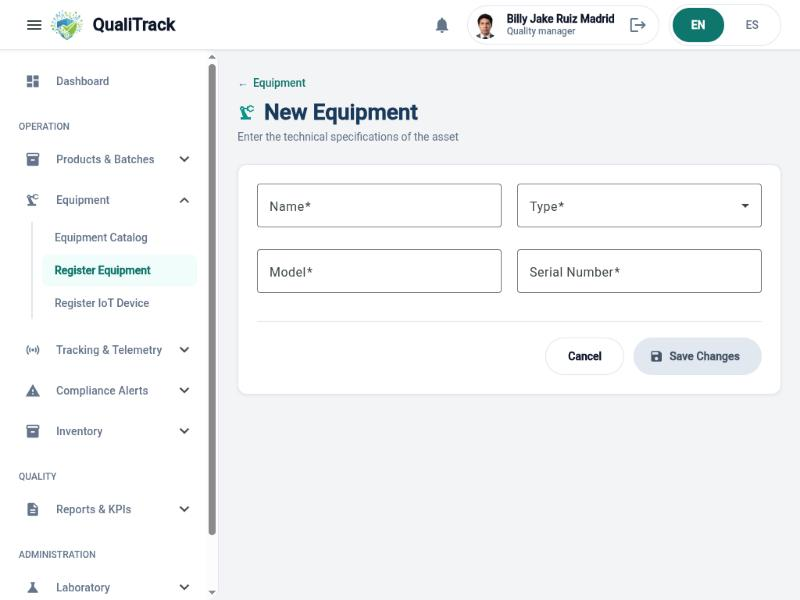

**Recomendación:**

Definir un único verbo para la creación (por ejemplo *Register*) y reservar *Save changes* para la edición. Usar el mismo nombre en el menú, el botón de acceso y el título de la pantalla.

**PROBLEMA #7:** Los botones deshabilitados no indican qué falta para poder continuar

**Severidad:** 2

**Heurística violada:** Usability: Visibilidad del estado del sistema

**Problema:**

En el generador de reportes los botones *Generate PDF* y de vista previa aparecen deshabilitados hasta que se elige un periodo, pero la pantalla no señala qué dato falta; el botón de vista previa es además un ícono sin texto. Lo mismo sucede con *Save Changes* en el registro de equipo, *Register device* en dispositivo IoT y *Move* / *Register change* en el detalle del equipo.

  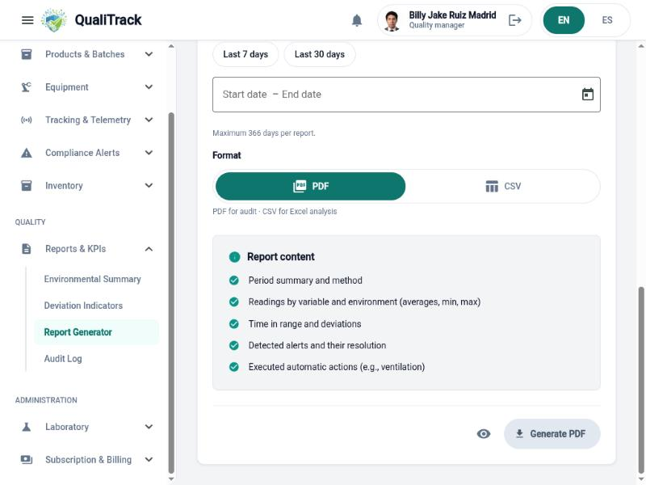

**Recomendación:**

Mostrar junto al botón un mensaje breve con el requisito pendiente (por ejemplo "Selecciona un periodo para generar el reporte") o mantener el botón activo y resaltar los campos incompletos al pulsarlo. Agregar texto o tooltip al botón de vista previa.

**PROBLEMA #8:** El registro de dispositivo IoT no valida el formato de la dirección MAC y usa términos técnicos internos

**Severidad:** 2

**Heurística violada:** Usability: Prevención de errores / Relación entre el sistema y el mundo real

**Problema:**

El campo *MAC address or serial number* muestra un ejemplo ("24:6F:28:AA:10:01") pero acepta cualquier texto: en el catálogo existe un dispositivo registrado con "20.7B.30.33.Z5.99", valor que no corresponde a una dirección MAC. Además, los textos de ayuda mencionan "the identity Edge uses to recognise it", un término de la arquitectura interna que el responsable de calidad no tiene por qué conocer.

  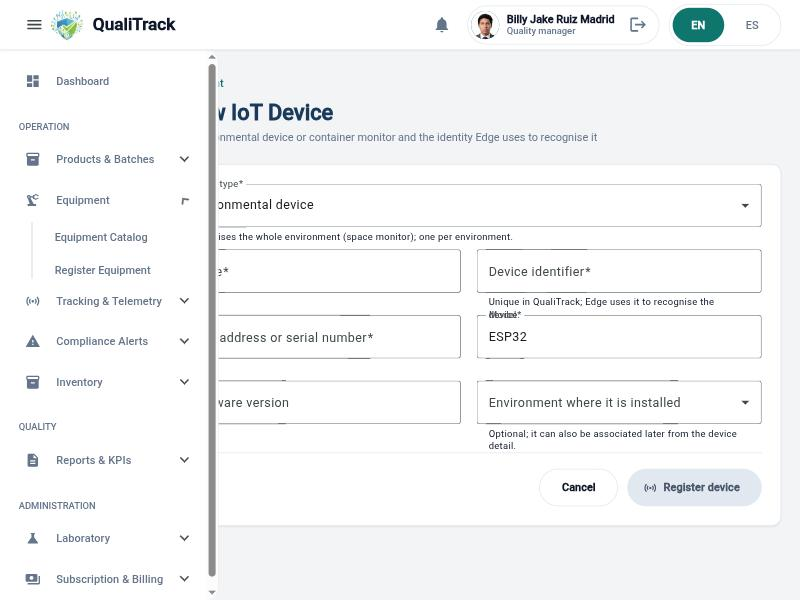

**Recomendación:**

Separar MAC y número de serie en campos distintos, aplicar una máscara de entrada para la MAC y validar su formato antes de guardar. Reemplazar "Edge" por una explicación en lenguaje del usuario ("el identificador con el que el dispositivo se conecta a QualiTrack").

**PROBLEMA #9:** El ambiente del equipo no se pide al registrarlo y el selector aparece vacío en el detalle

**Severidad:** 2

**Heurística violada:** Usability: Reconocer antes que recordar

**Problema:**

El formulario *New Equipment* solo solicita nombre, tipo, modelo y serie, aunque el catálogo muestra el ambiente como columna principal; el usuario debe guardar, abrir el detalle y usar la sección *Location* para asignarlo. En esa sección el selector *Environment* se muestra vacío incluso cuando el equipo ya tiene un ambiente asignado, de modo que el usuario debe mirar la cabecera para recordar dónde está el equipo antes de moverlo.

  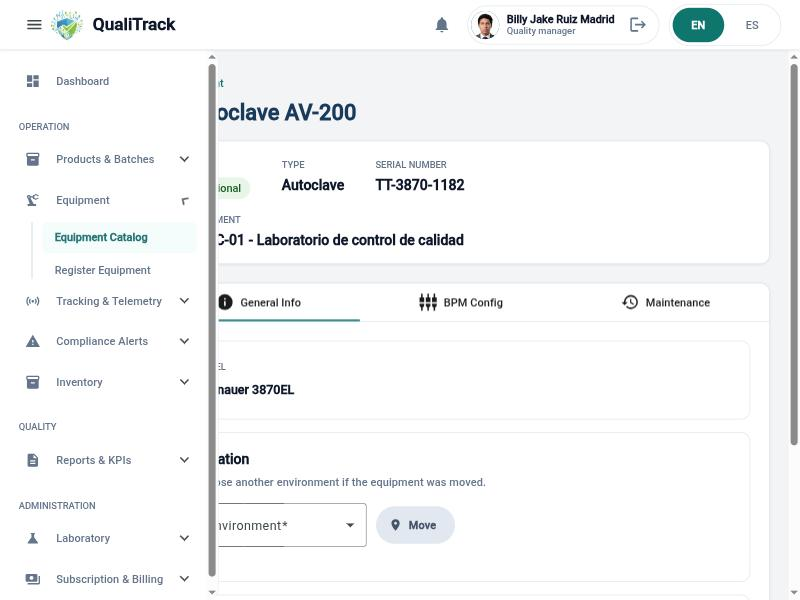

**Recomendación:**

Incluir el ambiente como campo del formulario de registro y, en el detalle, mostrar el ambiente actual preseleccionado en el selector.

**PROBLEMA #10:** El inventario no explica la diferencia entre "Usable stock" y "Physical balance"

**Severidad:** 2

**Heurística violada:** Information Architecture: Is it clear? / Usability: Ayuda y documentación

**Problema:**

La tabla de materias primas presenta dos cantidades por material (*Usable stock* y *Physical balance*) sin ninguna ayuda que explique por qué difieren; por ejemplo, "Agua purificada" figura con 0 L utilizables y 7 L de saldo físico. El botón *Previous balances* tampoco deja claro qué operación realiza. Un usuario nuevo no puede interpretar el indicador *Low usable stock* sin esa información.

  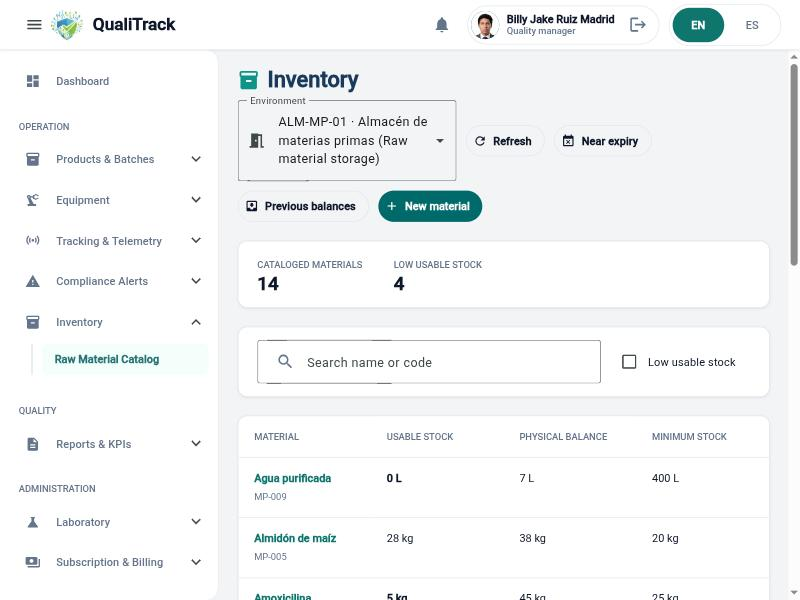

**Recomendación:**

Agregar un ícono de ayuda en cada encabezado con una definición corta (por ejemplo "Utilizable: saldo de lotes aprobados y no vencidos"), y renombrar *Previous balances* con un texto que describa la acción.

**PROBLEMA #11:** La tabla de personal queda cortada y la acción de desactivar es un ícono sin texto

**Severidad:** 2

**Heurística violada:** Information Architecture: Is it accessible? / Usability: Flexibilidad y eficiencia en el uso

**Problema:**

En una pantalla de 1024 px de ancho la tabla *Personnel Management* no muestra las columnas de estado laboral ni de acciones, que quedan fuera del área visible. La única acción por fila es un ícono sin etiqueta para desactivar a la persona, y la lista no tiene búsqueda ni filtros, a diferencia de equipos, inventario y lotes.

  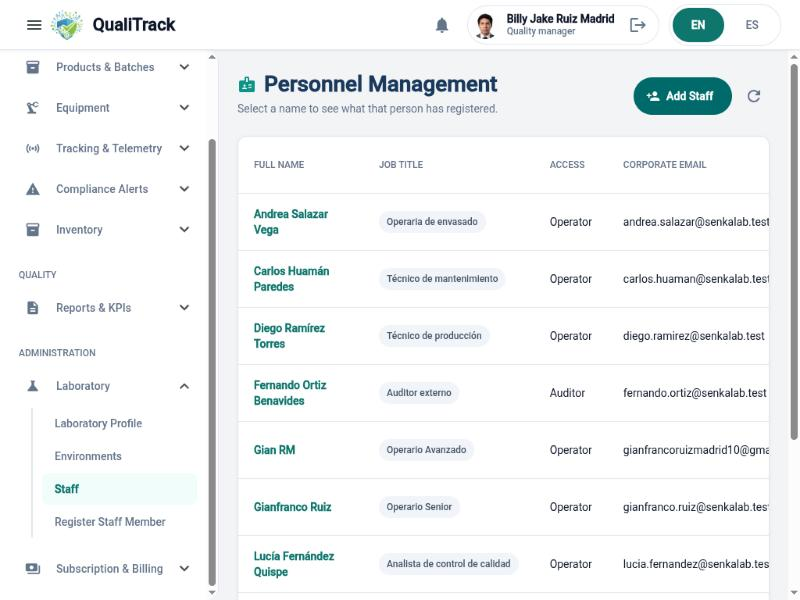

**Recomendación:**

Reducir el ancho de las columnas o apilar el correo bajo el nombre para que estado y acciones sean siempre visibles, acompañar el ícono con texto o tooltip, y agregar el mismo buscador que usan los demás catálogos.

**PROBLEMA #12:** El dashboard muestra un límite de equipos del plan menor que los equipos registrados

**Severidad:** 2

**Heurística violada:** Information Architecture: Is it credible?

**Problema:**

La tarjeta *Subscription & Billing* indica "Plan equipment limit: 5" mientras que el indicador superior del mismo dashboard muestra 14 equipos registrados. La pantalla no explica si el límite ya fue superado, si los dispositivos IoT no cuentan o si el dato está desactualizado, lo que resta confianza a la información mostrada.

  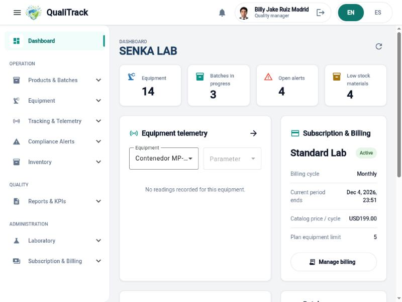

**Recomendación:**

Mostrar el uso frente al límite (por ejemplo "7 de 5 equipos") con una advertencia cuando se supera, y aclarar qué tipos de equipo cuentan para el plan.

**PROBLEMA #13:** El menú lateral tapa el borde izquierdo del contenido al abrir una pantalla directamente

**Severidad:** 2

**Heurística violada:** Usability: Diseño estético y minimalista / Information Architecture: Is it accessible?

**Problema:**

Al cargar una pantalla interna por su URL o al recargarla (por ejemplo el detalle de un equipo, el registro de dispositivo IoT o la liberación de un lote), el contenido se dibuja debajo del menú lateral durante varios segundos: los títulos y las etiquetas de los campos aparecen cortados por la izquierda hasta que el diseño se reacomoda.

  

**Recomendación:**

Reservar el ancho del menú lateral desde el primer renderizado, de modo que el contenido nunca quede debajo de él mientras la pantalla termina de cargar.

**PROBLEMA #14:** El texto de ayuda del número de lote se superpone con la etiqueta "Quantity"

**Severidad:** 1

**Heurística violada:** Usability: Diseño estético y minimalista

**Problema:**

En el formulario *Create Production Batch*, el texto de ayuda del campo *Batch Number* ("Unique in the laboratory, for example PB-2026-001") ocupa dos líneas y se monta sobre la etiqueta del campo *Quantity*, dejando ambos textos ilegibles.

  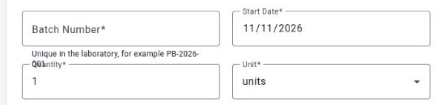

**Recomendación:**

Dar al texto de ayuda el espacio vertical necesario o acortarlo para que quepa en una línea.

#### 6.3.3.2. Evaluación a la aplicación móvil

  <h2>UX Heuristics & Principles Evaluation</h2>
  <h3>Usability – Inclusive Design – Information Architecture</h3>

<strong>CARRERA:</strong> Ingeniería de Software

<strong>CURSO:</strong> Desarrollo de soluciones IoT

<strong>PROFESOR:</strong> Ángel Augusto Velasquez Nuñez

<strong>AUDITOR:</strong> Equipo Qualitrack

<strong>PRODUCTO EVALUADO:</strong> QualiTrack Mobile Application

<strong>CLIENTE(S):</strong> Responsables de control de calidad y Técnicos de laboratorio

#### SITE o APP A EVALUAR

QualiTrack Mobile Application

#### TAREAS A EVALUAR

El alcance de esta evaluación incluye la revisión de la usabilidad de las siguientes tareas:

1. Inicio de sesión y restauración de la sesión al reabrir la app
2. Cambio obligatorio de la contraseña temporal en el primer ingreso del personal
3. Revisión de las prioridades del inicio (alertas, dispositivos IoT, lotes y materiales) y navegación a cada módulo
4. Monitoreo en vivo de las condiciones de un ambiente o contenedor
5. Consulta del historial de lecturas de telemetría
6. Atención y resolución de una alerta de desviación
7. Revisión de un lote de producción y de su trazabilidad
8. Liberación con firma digital o rechazo de un lote
9. Consulta del inventario de un ambiente (stock, lotes, vencimientos y movimientos)
10. Consulta de un equipo (conexión, límites BPM y mantenimiento)

No están incluidas en esta versión de la evaluación las siguientes tareas:

1. Consulta de indicadores de desviación e historial de reportes
2. Consulta de la suscripción y la facturación
3. Edición del perfil (datos personales, foto y contraseña)
4. Bandeja de notificaciones y preferencias de notificación
5. Consulta del catálogo de productos y de la pantalla "Acerca de"

#### ESCALA DE SEVERIDAD

Los errores serán puntuados tomando en cuenta la siguiente escala de severidad:

| Nivel | Descripción                                                                                                                                                       |
| :---: | :---------------------------------------------------------------------------------------------------------------------------------------------------------------- |
|   1   | **Problema superficial:** puede ser superado fácilmente por el usuario u ocurre con muy poca frecuencia. No necesita corregirse salvo que haya tiempo disponible. |
|   2   | **Problema menor:** ocurre un poco más seguido o es algo más difícil de superar. Se le asigna prioridad baja para el siguiente release.                           |
|   3   | **Problema mayor:** ocurre con frecuencia o el usuario no logra resolverlo. Es importante corregirlo; se le asigna prioridad alta.                                |
|   4   | **Problema muy grave:** error de gran impacto que impide al usuario continuar usando la herramienta. Es imperativo corregirlo antes del lanzamiento.              |

#### TABLA RESUMEN

| #   | Problema | Escala de severidad | Heurística/Principio violada(o) |
| :-: | -------- | :-----------------: | ------------------------------- |
| 1 | Los nombres de las materias primas aparecen cortados en el inventario | 3 | Information Architecture: Is it clear? / Usability: Prevención de errores |
| 2 | La lista de alertas muestra las ya reconocidas por encima de las críticas sin resolver | 2 | Usability: Visibilidad del estado del sistema / Flexibilidad y eficiencia en el uso |
| 3 | Los lotes pendientes y en progreso se rotulan como "En espera de liberación QA" | 2 | Information Architecture: Is it communicative? / Usability: Relación entre el sistema y el mundo real |
| 4 | La interfaz en español mezcla términos en inglés | 2 | Usability: Consistencia y estándares / Relación entre el sistema y el mundo real |
| 5 | El detalle de la alerta muestra dos fechas distintas sin indicar qué representa cada una | 2 | Information Architecture: Is it clear? |
| 6 | La app móvil y la web nombran de forma distinta los estados y acciones de una alerta | 2 | Usability: Consistencia y estándares |
| 7 | Hay íconos y contadores sin texto que no se explican | 2 | Usability: Reconocer antes que recordar |
| 8 | El botón flotante de filtros tapa parte del contenido de las listas | 2 | Usability: Diseño estético y minimalista |
| 9 | Varios textos se cortan con puntos suspensivos en cabeceras, selectores y pestañas | 2 | Information Architecture: Is it clear? |
| 10 | El estado "Requiere revisión" de un dispositivo no indica qué debe hacer el usuario | 2 | Usability: Ayuda a los usuarios a reconocer, diagnosticar y recuperarse de los errores |
| 11 | El inicio de sesión no ofrece recuperar la contraseña | 2 | Usability: Libertad y control por parte del usuario / Ayuda y documentación |

#### DESCRIPCIÓN DE PROBLEMAS

**PROBLEMA #1:** Los nombres de las materias primas aparecen cortados en el inventario

**Severidad:** 3

**Heurística violada:** Information Architecture: Is it clear? / Usability: Prevención de errores

**Problema:**

En *Inventario de Materias Primas* el nombre de cada material se trunca a una sola línea porque comparte la fila con la etiqueta de estado: se lee "Amoxicilina trihidr…", "Cápsula de gelatin…" o "Estearato de magn…". En un catálogo farmacéutico varios materiales comparten el inicio del nombre y solo se distinguen por la concentración o la presentación, de modo que el usuario puede confundir un material con otro sin abrir cada ficha.

  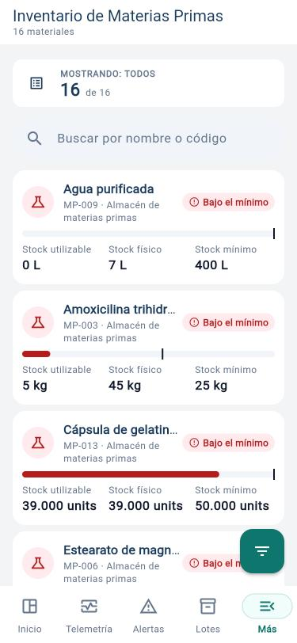

**Recomendación:**

Permitir que el nombre ocupe dos líneas y mover la etiqueta de estado debajo del código, como ya se hace en las tarjetas de equipos.

**PROBLEMA #2:** La lista de alertas muestra las ya reconocidas por encima de las críticas sin resolver

**Severidad:** 2

**Heurística violada:** Usability: Visibilidad del estado del sistema / Flexibilidad y eficiencia en el uso

**Problema:**

La pestaña *Alertas* ordena por fecha: las dos alertas con estado "Reconocida" aparecen primero y las dos críticas "Sin resolver", que nadie ha atendido, quedan al final. La tarjeta "Últimas alertas" del inicio repite el mismo criterio y muestra una alerta ya reconocida. El usuario que abre la app para atender lo urgente debe recorrer la lista para encontrarlo.

  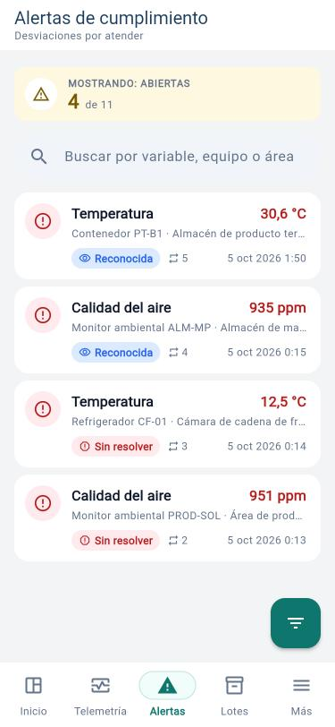

**Recomendación:**

Ordenar por defecto según prioridad (primero las críticas sin resolver) y ofrecer el orden por fecha como alternativa visible, igual que en la versión web.

**PROBLEMA #3:** Los lotes pendientes y en progreso se rotulan como "En espera de liberación QA"

**Severidad:** 2

**Heurística violada:** Information Architecture: Is it communicative? / Usability: Relación entre el sistema y el mundo real

**Problema:**

Cada tarjeta de la lista de lotes muestra a la vez la etiqueta de estado ("Pendiente" o "En progreso") y el texto "En espera de liberación QA", y la tarjeta *Lotes* del inicio cuenta 6 lotes "en espera de liberación QA". Un lote pendiente todavía no ha consumido materia prima y uno en progreso sigue en fabricación, por lo que ninguno está realmente esperando la decisión de calidad. Los dos mensajes se contradicen y el indicador del inicio pierde significado.

  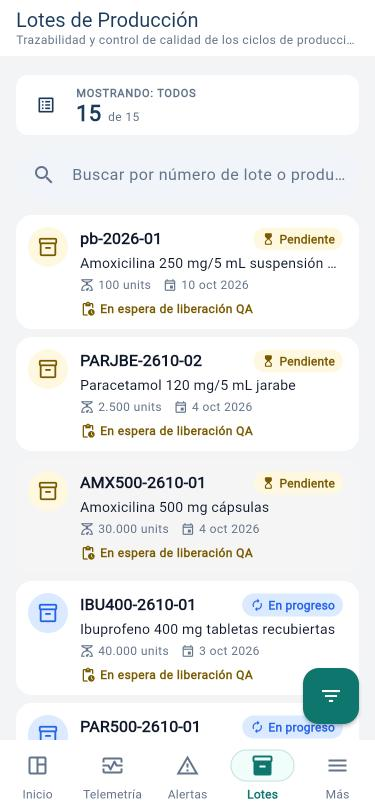

**Recomendación:**

Mostrar "En espera de liberación QA" solo cuando el lote terminó su fabricación y falta la decisión, o reemplazarlo por un texto que describa la etapa real ("Sin consumo de materias primas", "En fabricación").

**PROBLEMA #4:** La interfaz en español mezcla términos en inglés

**Severidad:** 2

**Heurística violada:** Usability: Consistencia y estándares / Relación entre el sistema y el mundo real

**Problema:**

Con la app en español, las cantidades se muestran como "100 units" o "40.000 units" en lotes, inventario y trazabilidad; el tipo de equipo aparece como "Centrifuge"; y los mantenimientos se listan como "Preventive" y "Calibration". El resto de la pantalla está traducido, por lo que estos valores se perciben como errores.

  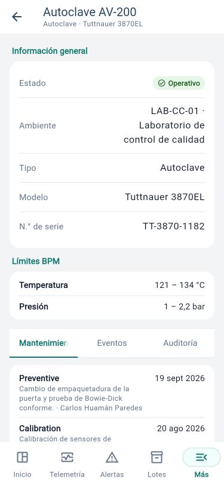

**Recomendación:**

Traducir las unidades, los tipos de equipo y los tipos de mantenimiento con el mismo mecanismo de etiquetas que ya se usa para los estados ("unidades", "Centrífuga", "Preventivo", "Calibración").

**PROBLEMA #5:** El detalle de la alerta muestra dos fechas distintas sin indicar qué representa cada una

**Severidad:** 2

**Heurística violada:** Information Architecture: Is it clear?

**Problema:**

La cabecera del detalle de la alerta #9 muestra "5 oct 2026 0:14" sin ningún rótulo, mientras que la sección *Inspección técnica* indica "Primera detección: 4 oct 2026 19:04". El usuario no puede saber si la fecha de la cabecera es la apertura, la última desviación o la última actualización, y la lista de alertas usa esa misma fecha sin explicarla.

  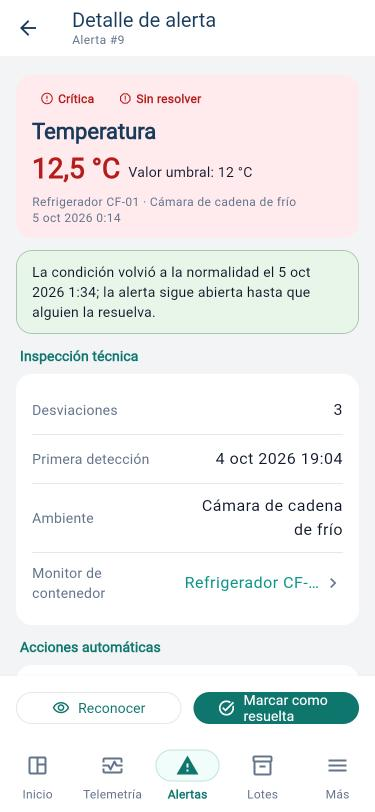

**Recomendación:**

Rotular la fecha de la cabecera (por ejemplo "Última desviación") y mostrar junto a ella el tiempo transcurrido desde que se abrió la alerta.

**PROBLEMA #6:** La app móvil y la web nombran de forma distinta los estados y acciones de una alerta

**Severidad:** 2

**Heurística violada:** Usability: Consistencia y estándares

**Problema:**

En la app móvil la acción se llama "Reconocer" y los estados son "Reconocida" y "Sin resolver". En QualiTrack Web, también en español, la misma acción se llama "Registrar atención" y los estados son "En atención" y "Sin atender". Un responsable de calidad que usa ambas plataformas debe aprender dos vocabularios para el mismo flujo.

  

**Recomendación:**

Acordar un único término por acción y por estado y aplicarlo en las dos plataformas.

**PROBLEMA #7:** Hay íconos y contadores sin texto que no se explican

**Severidad:** 2

**Heurística violada:** Usability: Reconocer antes que recordar

**Problema:**

Las tarjetas de alerta muestran un ícono de flechas seguido de un número ("⇄ 5") que corresponde a la cantidad de desviaciones, pero nada lo indica. El botón flotante de filtros es solo un ícono, y la pantalla de telemetría tiene en la esquina superior derecha un ícono sin etiqueta que abre el registro de lecturas.

  

**Recomendación:**

Acompañar el contador con su unidad ("5 desviaciones"), agregar texto al botón de filtros ("Filtrar") y usar un ícono con etiqueta o un tooltip para el acceso al registro de telemetría.

**PROBLEMA #8:** El botón flotante de filtros tapa parte del contenido de las listas

**Severidad:** 2

**Heurística violada:** Usability: Diseño estético y minimalista

**Problema:**

En las listas de equipos, inventario, lotes y alertas, el botón flotante de filtros queda encima de la última tarjeta visible. En equipos oculta la etiqueta "Monitor de contenedor" y en inventario tapa la etiqueta "Bajo el mínimo", que es justamente el dato que el usuario busca.

  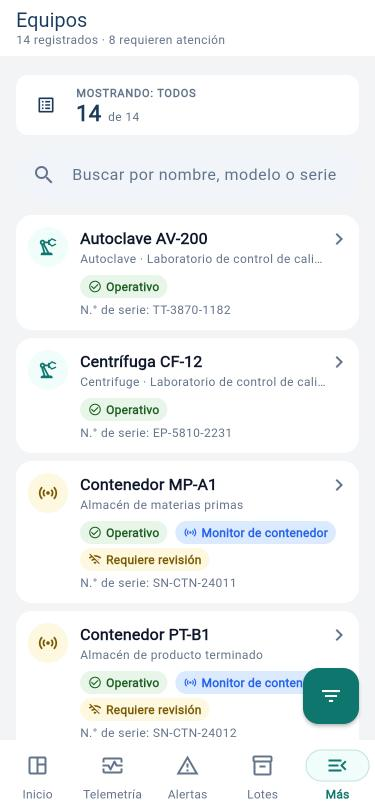

**Recomendación:**

Ubicar el filtro junto al buscador en la parte superior, o reservar un margen inferior en la lista para que ninguna tarjeta quede debajo del botón.

**PROBLEMA #9:** Varios textos se cortan con puntos suspensivos en cabeceras, selectores y pestañas

**Severidad:** 2

**Heurística violada:** Information Architecture: Is it clear?

**Problema:**

A 375 px de ancho se cortan el subtítulo de telemetría ("Datos sensoriales y monitoreo de parámetros en t…"), el selector de dispositivo ("Contenedor MP-A1 · Almacén de …"), el buscador de lotes ("Buscar por número de lote o produ…"), la ubicación en las tarjetas de alerta ("Almacén de producto ter…") y la pestaña "Mantenimien" del detalle de equipo. En el selector de dispositivo el texto cortado es el ambiente, necesario para distinguir dos monitores con nombres parecidos.

  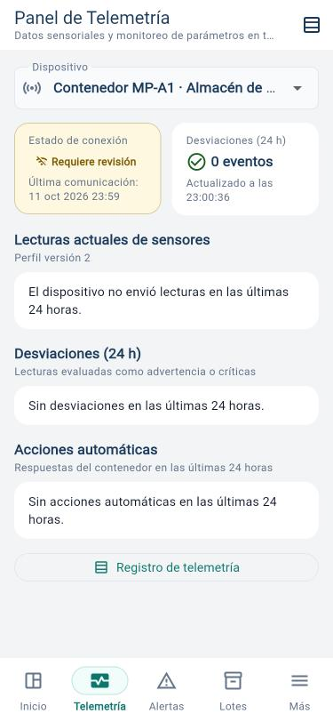

**Recomendación:**

Acortar los subtítulos y marcadores de posición, mostrar el ambiente en una segunda línea del selector y usar pestañas desplazables o rótulos más cortos ("Mantto.").

**PROBLEMA #10:** El estado "Requiere revisión" de un dispositivo no indica qué debe hacer el usuario

**Severidad:** 2

**Heurística violada:** Usability: Ayuda a los usuarios a reconocer, diagnosticar y recuperarse de los errores

**Problema:**

El inicio informa "0/7 dispositivos en línea" y "Requiere revisión 7", y el panel de telemetría muestra "Requiere revisión" con la última comunicación de hace un mes y el mensaje "El dispositivo no envió lecturas en las últimas 24 horas". En ningún punto se explica la causa probable ni el siguiente paso (revisar energía, red o contactar a mantenimiento). También aparece "Perfil versión 2", un dato interno sin significado para el usuario.

  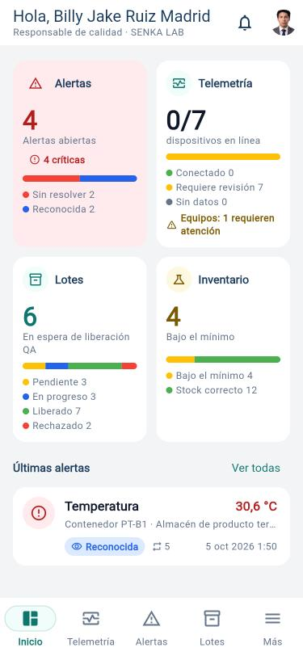

**Recomendación:**

Agregar al estado una explicación corta con la causa probable y la acción sugerida, mostrar cuánto tiempo lleva sin comunicarse el dispositivo y retirar o explicar "Perfil versión".

**PROBLEMA #11:** El inicio de sesión no ofrece recuperar la contraseña

**Severidad:** 2

**Heurística violada:** Usability: Libertad y control por parte del usuario / Ayuda y documentación

**Problema:**

La pantalla *Iniciar sesión* solo tiene usuario, contraseña y el texto "Las cuentas se crean y administran en QualiTrack Web". No existe la opción "¿Olvidaste tu contraseña?" que sí ofrece la versión web, por lo que un operario que olvida su contraseña en planta queda bloqueado sin una indicación de cómo recuperarla.

  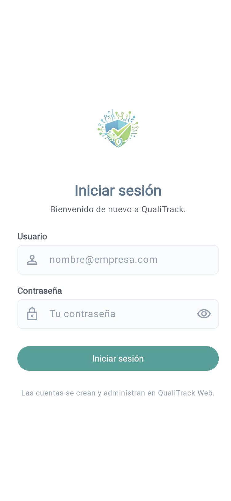

**Recomendación:**

Agregar un enlace de recuperación que abra el flujo de la web o, como mínimo, un texto que indique dónde recuperar la contraseña.

## 6.4 Video About-The-Product

  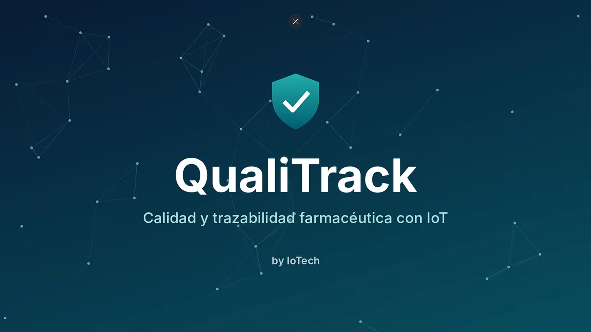

 

El video About the Product presenta QualiTrack, la solución de IoTech para la gestión y el control de calidad en laboratorios farmacéuticos. Tiene una duración de 46 segundos, está en formato Full HD (1920 × 1080) y su narrativa visual está en español.

El video comienza planteando el problema: en un laboratorio farmacéutico, la calidad no puede depender de registros manuales, que generan errores humanos y trazabilidad incompleta frente a auditorías BPM/GMP cada vez más exigentes. A continuación presenta la solución en cinco momentos:

1. **Dispositivos IoT.** Se muestran el monitor de contenedor, un gabinete con control de temperatura, humedad y luz y lectura RFID de los lotes, y el monitor de ambiente, que mide la calidad del aire y detecta movimiento. Ambos indican su estado con un LED (verde: normal; amarillo: advertencia; rojo: crítica).
2. **Panel web.** Resume en una sola vista los equipos, los lotes en progreso, las alertas abiertas y los materiales por debajo del mínimo.
3. **Alertas críticas.** Muestra cómo se notifican en la web y en la aplicación móvil, con estados consistentes en ambas plataformas.
4. **Trazabilidad de lotes.** Permite consultar las materias primas y los equipos usados, el historial de cada acción y la firma digital de liberación.
5. **Reportes para auditoría.** Genera reportes de lote, ambientales, de inventario y de equipos, en PDF y CSV, listos para una auditoría de DIGEMID.

El video cierra con los tres beneficios principales del producto: cumplimiento de BPM, reducción de errores humanos y trazabilidad total. Su objetivo es comunicar, en menos de un minuto, qué problema resuelve QualiTrack, cómo funcionan sus dispositivos y su plataforma, y qué valor aporta a un laboratorio.

[Ver el video About-The-Product](https://youtu.be/pD8I8iiFkXQ?si=FyAmgIjk9ySbif4L)
