## 6.3. Validation Interviews

### 6.3.1. Diseño de Entrevista

### 6.3.2 Registro de Entrevista

### 6.3.3 Evaluaciones según Heuristica

#### 6.3.3.1. Evaluación a la aplicación web

  <h2>UX Heuristics & Principles Evaluation</h2>
  <h3>Usability – Inclusive Design – Information Architecture</h3>

<strong>CARRERA:</strong> Ingeniería de Software

<strong>CURSO:</strong> Desarrollo de soluciones IoT

<strong>PROFESOR:</strong> Ángel Augusto Velasquez Nuñez

<strong>AUDITOR:</strong> Equipo Qualitrack

<strong>PRODUCTO EVALUADO:</strong> QualiTrack Web Application

<strong>CLIENTE(S):</strong> Responsables de control de calidad y Técnicos de laboratorio

#### SITE o APP A EVALUAR

Qualitrack Web Application

#### TAREAS A EVALUAR

El alcance de esta evaluación incluye la revisión de la usabilidad de las siguientes tareas:

1. Registro de cuenta e inicio de sesión
2. Onboarding: cambio de la contraseña temporal y creación del laboratorio
3. Registro de personal del laboratorio
4. Registro de un equipo y de un dispositivo IoT
5. Configuración de los parámetros BPM de un equipo
6. Registro de una materia prima
7. Registro de un producto y creación de un lote
8. Liberación o rechazo de un lote
9. Atención y resolución de una alerta de desviación
10. Generación de un reporte

No están incluidas en esta versión de la evaluación las siguientes tareas:

1. Pago de una suscripción en Stripe (formulario de pago, página de éxito y de cancelación)
2. Cancelación de la suscripción y consulta del resumen de facturación
3. Monitoreo ambiental en vivo y consulta del historial de telemetría
4. Acceso a las rutas heredadas (legacy) que solo redirigen a otras vistas
5. Consulta del perfil y de la actividad de otro miembro del personal
6. Importación de registros de pre-inventario y asignación de contenedores

#### ESCALA DE SEVERIDAD

Los errores serán puntuados tomando en cuenta la siguiente escala de severidad:

| Nivel | Descripción                                                                                                                                                       |
| :---: | :---------------------------------------------------------------------------------------------------------------------------------------------------------------- |
|   1   | **Problema superficial:** puede ser superado fácilmente por el usuario u ocurre con muy poca frecuencia. No necesita corregirse salvo que haya tiempo disponible. |
|   2   | **Problema menor:** ocurre un poco más seguido o es algo más difícil de superar. Se le asigna prioridad baja para el siguiente release.                           |
|   3   | **Problema mayor:** ocurre con frecuencia o el usuario no logra resolverlo. Es importante corregirlo; se le asigna prioridad alta.                                |
|   4   | **Problema muy grave:** error de gran impacto que impide al usuario continuar usando la herramienta. Es imperativo corregirlo antes del lanzamiento.              |

#### TABLA RESUMEN

| #   | Problema | Escala de severidad | Heurística/Principio violada(o) |
| :-: | -------- | :-----------------: | ------------------------------- |
| 1 | No existe una acción para crear un lote desde la vista de lotes de producción | 3 | Information Architecture: Is it findable? / Usability: Flexibilidad y eficiencia en el uso |
| 2 | Los formularios de liberación y rechazo no muestran los datos del lote sobre el que se decide | 3 | Usability: Reconocer antes que recordar / Prevención de errores |
| 3 | El nombre y la unidad de un parámetro BPM se ingresan como texto libre | 3 | Usability: Prevención de errores |
| 4 | Los parámetros BPM registrados no muestran acciones para editarlos o eliminarlos | 3 | Usability: Libertad y control por parte del usuario |
| 5 | El botón para agregar un parámetro BPM está rotulado como "Parameter Name" | 2 | Usability: Consistencia y estándares / Information Architecture: Is it communicative? |
| 6 | Las acciones de registro usan nombres distintos en cada módulo | 2 | Usability: Consistencia y estándares |
| 7 | Los botones deshabilitados no indican qué falta para poder continuar | 2 | Usability: Visibilidad del estado del sistema |
| 8 | El registro de dispositivo IoT no valida el formato de la dirección MAC y usa términos técnicos internos | 2 | Usability: Prevención de errores / Relación entre el sistema y el mundo real |
| 9 | El ambiente del equipo no se pide al registrarlo y el selector aparece vacío en el detalle | 2 | Usability: Reconocer antes que recordar |
| 10 | El inventario no explica la diferencia entre "Usable stock" y "Physical balance" | 2 | Information Architecture: Is it clear? / Usability: Ayuda y documentación |
| 11 | La tabla de personal queda cortada y la acción de desactivar es un ícono sin texto | 2 | Information Architecture: Is it accessible? / Usability: Flexibilidad y eficiencia en el uso |
| 12 | El dashboard muestra un límite de equipos del plan menor que los equipos registrados | 2 | Information Architecture: Is it credible? |
| 13 | El menú lateral tapa el borde izquierdo del contenido al abrir una pantalla directamente | 2 | Usability: Diseño estético y minimalista / Information Architecture: Is it accessible? |
| 14 | El texto de ayuda del número de lote se superpone con la etiqueta "Quantity" | 1 | Usability: Diseño estético y minimalista |

#### DESCRIPCIÓN DE PROBLEMAS

**PROBLEMA #1:** No existe una acción para crear un lote desde la vista de lotes de producción

**Severidad:** 3

**Heurística violada:** Information Architecture: Is it findable? / Usability: Flexibilidad y eficiencia en el uso

**Problema:**

La vista *Production Batches* lista, filtra y pagina los lotes, pero no ofrece ningún botón para crear uno. El único botón principal lleva a *Pharmaceutical products*; para crear un lote el usuario debe ir al catálogo de productos, elegir el ambiente, abrir el producto y recién ahí pulsar *New Batch*. Quien entra a la vista de lotes con la intención de registrar un lote no encuentra la acción donde la espera.

  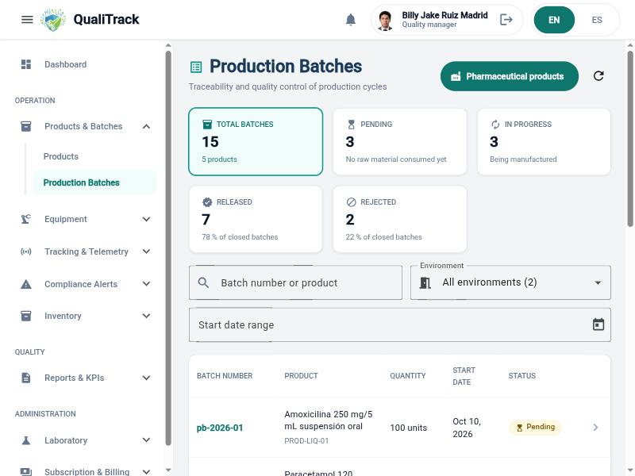

**Recomendación:**

Agregar un botón *New Batch* en la cabecera de *Production Batches* que permita elegir el producto dentro del mismo formulario, manteniendo el acceso actual desde el detalle del producto.

**PROBLEMA #2:** Los formularios de liberación y rechazo no muestran los datos del lote sobre el que se decide

**Severidad:** 3

**Heurística violada:** Usability: Reconocer antes que recordar / Prevención de errores

**Problema:**

Al pulsar *Release Batch* o *Reject Batch* se abre una pantalla aparte que solo contiene la fecha y un campo de notas. No se muestra el número de lote, el producto, la cantidad ni las especificaciones de calidad, y el enlace de retorno dice únicamente *Batch Detail*. La liberación es una decisión firmada e irreversible ("the batch can no longer be modified"), por lo que el responsable de calidad debe recordar de memoria qué lote estaba revisando. En el formulario de rechazo, además, no se advierte que la acción sea definitiva.

  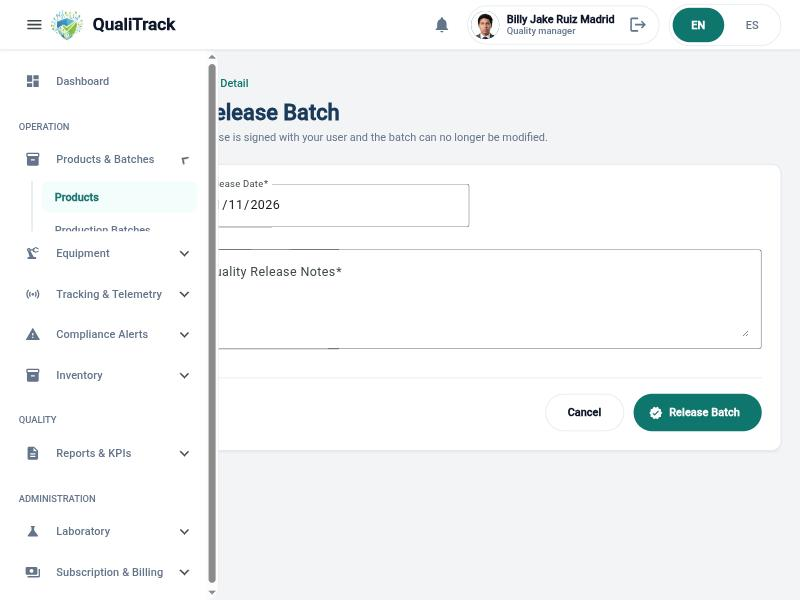

**Recomendación:**

Mostrar en ambos formularios un resumen del lote (número, producto, cantidad, ambiente y especificaciones BPM) y pedir una confirmación explícita que repita el número de lote antes de registrar la decisión. Indicar también en el rechazo que la acción no se puede deshacer.

**PROBLEMA #3:** El nombre y la unidad de un parámetro BPM se ingresan como texto libre

**Severidad:** 3

**Heurística violada:** Usability: Prevención de errores

**Problema:**

En *BPM Parameter Config* los campos *Parameter Name* y *Unit* son cajas de texto sin lista de opciones, sugerencias ni ejemplos. El usuario puede escribir "Temperatura", "Temperature" o "Temp." y "°C" o "C" para la misma variable, lo que genera parámetros que no coinciden con las variables que reporta la telemetría. La pantalla tampoco indica a qué equipo pertenece el parámetro que se está creando.

  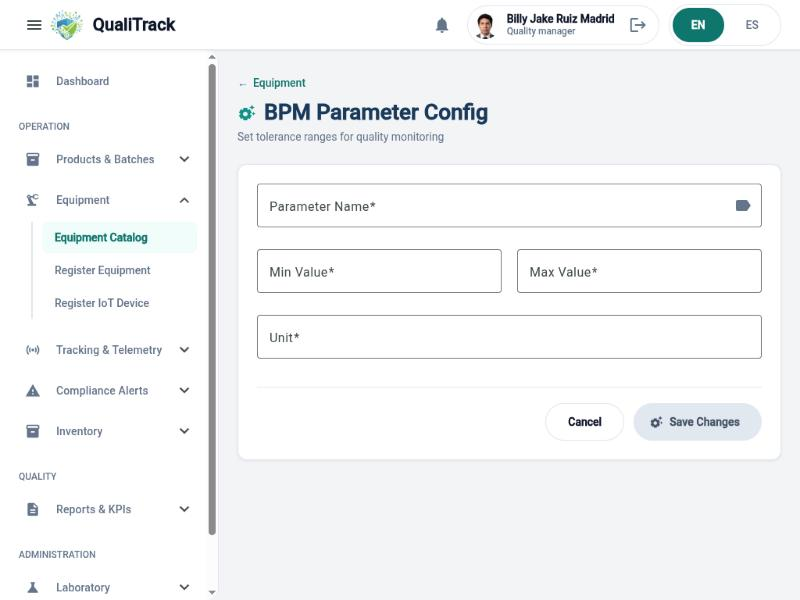

**Recomendación:**

Reemplazar el nombre por una lista de las variables que el sistema monitorea (temperatura, humedad, presión, calidad de aire) y autocompletar la unidad según la variable elegida. Mostrar el nombre del equipo en el encabezado del formulario y validar que el mínimo sea menor que el máximo.

**PROBLEMA #4:** Los parámetros BPM registrados no muestran acciones para editarlos o eliminarlos

**Severidad:** 3

**Heurística violada:** Usability: Libertad y control por parte del usuario

**Problema:**

La pestaña *BPM Config* del equipo lista cada parámetro con su rango (por ejemplo "Temperatura 121 - 134 °C"), pero las filas no presentan ninguna acción visible para corregir un rango mal ingresado ni para retirar un parámetro. Si el usuario se equivoca al registrar un límite, no tiene una salida evidente para deshacer el error.

  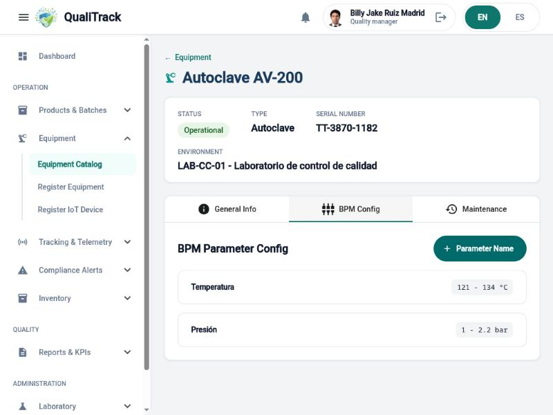

**Recomendación:**

Agregar en cada fila las acciones *Editar* y *Eliminar* (esta última con confirmación), y registrar el cambio en el historial del equipo.

**PROBLEMA #5:** El botón para agregar un parámetro BPM está rotulado como "Parameter Name"

**Severidad:** 2

**Heurística violada:** Usability: Consistencia y estándares / Information Architecture: Is it communicative?

**Problema:**

En la pestaña *BPM Config* el botón principal muestra el texto "+ Parameter Name", que es la etiqueta de un campo y no una acción. El usuario debe deducir por el ícono "+" que ese botón sirve para agregar un parámetro.

  

**Recomendación:**

Cambiar el rótulo a "Add parameter" / "Agregar parámetro", siguiendo el patrón verbo + objeto que usan los demás botones de la aplicación.

**PROBLEMA #6:** Las acciones de registro usan nombres distintos en cada módulo

**Severidad:** 2

**Heurística violada:** Usability: Consistencia y estándares

**Problema:**

La misma acción de crear un registro recibe rótulos diferentes según la pantalla: *Save Changes* al crear un equipo o un parámetro BPM (aunque no se está modificando nada), *Save* en materia prima, *Register* en producto, lote y personal, y *Register device* en dispositivo IoT. Ocurre lo mismo entre el menú y las pantallas: el menú dice *Register Equipment* y la pantalla se titula *New Equipment*; el menú dice *Register Staff Member* y el botón de la lista dice *Add Staff*.

  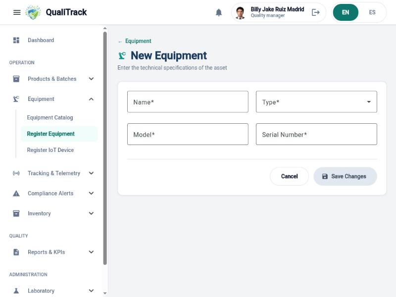

**Recomendación:**

Definir un único verbo para la creación (por ejemplo *Register*) y reservar *Save changes* para la edición. Usar el mismo nombre en el menú, el botón de acceso y el título de la pantalla.

**PROBLEMA #7:** Los botones deshabilitados no indican qué falta para poder continuar

**Severidad:** 2

**Heurística violada:** Usability: Visibilidad del estado del sistema

**Problema:**

En el generador de reportes los botones *Generate PDF* y de vista previa aparecen deshabilitados hasta que se elige un periodo, pero la pantalla no señala qué dato falta; el botón de vista previa es además un ícono sin texto. Lo mismo sucede con *Save Changes* en el registro de equipo, *Register device* en dispositivo IoT y *Move* / *Register change* en el detalle del equipo.

  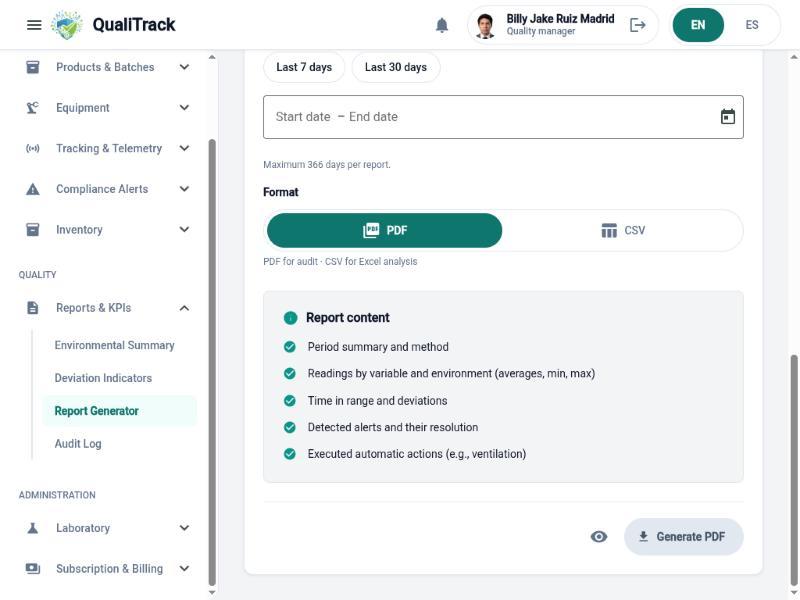

**Recomendación:**

Mostrar junto al botón un mensaje breve con el requisito pendiente (por ejemplo "Selecciona un periodo para generar el reporte") o mantener el botón activo y resaltar los campos incompletos al pulsarlo. Agregar texto o tooltip al botón de vista previa.

**PROBLEMA #8:** El registro de dispositivo IoT no valida el formato de la dirección MAC y usa términos técnicos internos

**Severidad:** 2

**Heurística violada:** Usability: Prevención de errores / Relación entre el sistema y el mundo real

**Problema:**

El campo *MAC address or serial number* muestra un ejemplo ("24:6F:28:AA:10:01") pero acepta cualquier texto: en el catálogo existe un dispositivo registrado con "20.7B.30.33.Z5.99", valor que no corresponde a una dirección MAC. Además, los textos de ayuda mencionan "the identity Edge uses to recognise it", un término de la arquitectura interna que el responsable de calidad no tiene por qué conocer.

  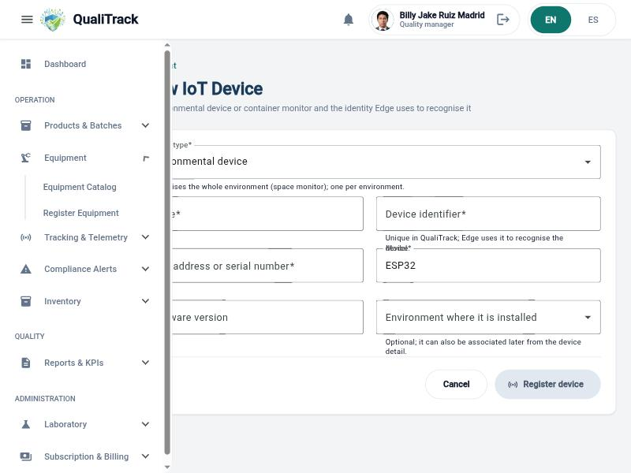

**Recomendación:**

Separar MAC y número de serie en campos distintos, aplicar una máscara de entrada para la MAC y validar su formato antes de guardar. Reemplazar "Edge" por una explicación en lenguaje del usuario ("el identificador con el que el dispositivo se conecta a QualiTrack").

**PROBLEMA #9:** El ambiente del equipo no se pide al registrarlo y el selector aparece vacío en el detalle

**Severidad:** 2

**Heurística violada:** Usability: Reconocer antes que recordar

**Problema:**

El formulario *New Equipment* solo solicita nombre, tipo, modelo y serie, aunque el catálogo muestra el ambiente como columna principal; el usuario debe guardar, abrir el detalle y usar la sección *Location* para asignarlo. En esa sección el selector *Environment* se muestra vacío incluso cuando el equipo ya tiene un ambiente asignado, de modo que el usuario debe mirar la cabecera para recordar dónde está el equipo antes de moverlo.

  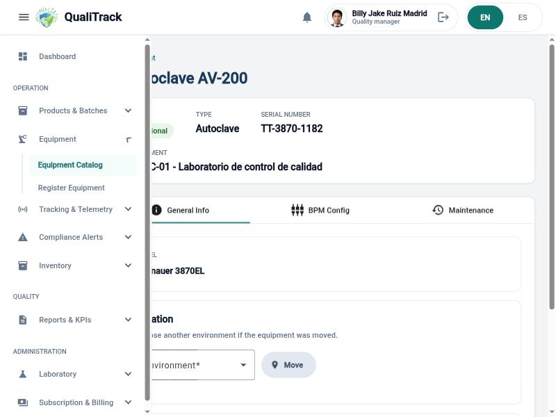

**Recomendación:**

Incluir el ambiente como campo del formulario de registro y, en el detalle, mostrar el ambiente actual preseleccionado en el selector.

**PROBLEMA #10:** El inventario no explica la diferencia entre "Usable stock" y "Physical balance"

**Severidad:** 2

**Heurística violada:** Information Architecture: Is it clear? / Usability: Ayuda y documentación

**Problema:**

La tabla de materias primas presenta dos cantidades por material (*Usable stock* y *Physical balance*) sin ninguna ayuda que explique por qué difieren; por ejemplo, "Agua purificada" figura con 0 L utilizables y 7 L de saldo físico. El botón *Previous balances* tampoco deja claro qué operación realiza. Un usuario nuevo no puede interpretar el indicador *Low usable stock* sin esa información.

  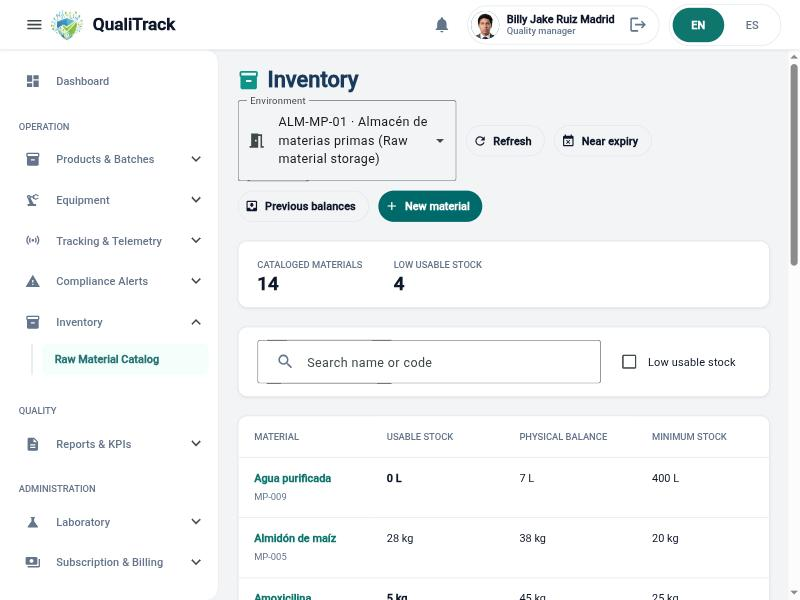

**Recomendación:**

Agregar un ícono de ayuda en cada encabezado con una definición corta (por ejemplo "Utilizable: saldo de lotes aprobados y no vencidos"), y renombrar *Previous balances* con un texto que describa la acción.

**PROBLEMA #11:** La tabla de personal queda cortada y la acción de desactivar es un ícono sin texto

**Severidad:** 2

**Heurística violada:** Information Architecture: Is it accessible? / Usability: Flexibilidad y eficiencia en el uso

**Problema:**

En una pantalla de 1024 px de ancho la tabla *Personnel Management* no muestra las columnas de estado laboral ni de acciones, que quedan fuera del área visible. La única acción por fila es un ícono sin etiqueta para desactivar a la persona, y la lista no tiene búsqueda ni filtros, a diferencia de equipos, inventario y lotes.

  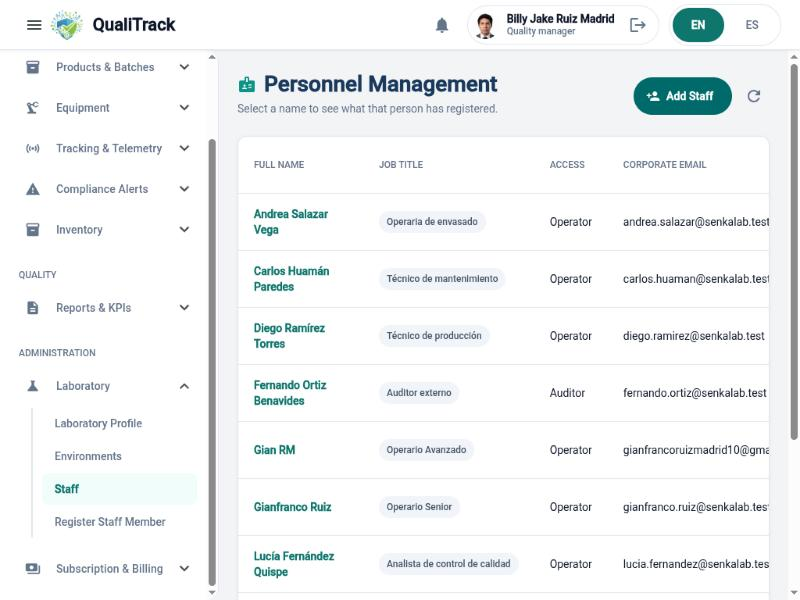

**Recomendación:**

Reducir el ancho de las columnas o apilar el correo bajo el nombre para que estado y acciones sean siempre visibles, acompañar el ícono con texto o tooltip, y agregar el mismo buscador que usan los demás catálogos.

**PROBLEMA #12:** El dashboard muestra un límite de equipos del plan menor que los equipos registrados

**Severidad:** 2

**Heurística violada:** Information Architecture: Is it credible?

**Problema:**

La tarjeta *Subscription & Billing* indica "Plan equipment limit: 5" mientras que el indicador superior del mismo dashboard muestra 14 equipos registrados. La pantalla no explica si el límite ya fue superado, si los dispositivos IoT no cuentan o si el dato está desactualizado, lo que resta confianza a la información mostrada.

  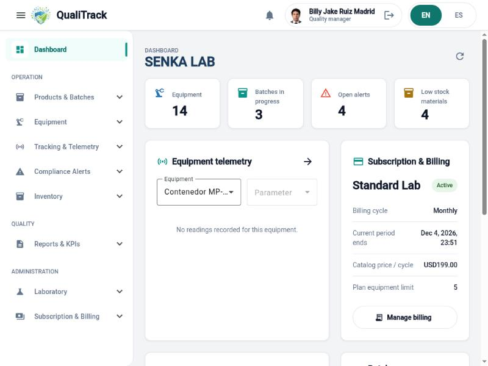

**Recomendación:**

Mostrar el uso frente al límite (por ejemplo "7 de 5 equipos") con una advertencia cuando se supera, y aclarar qué tipos de equipo cuentan para el plan.

**PROBLEMA #13:** El menú lateral tapa el borde izquierdo del contenido al abrir una pantalla directamente

**Severidad:** 2

**Heurística violada:** Usability: Diseño estético y minimalista / Information Architecture: Is it accessible?

**Problema:**

Al cargar una pantalla interna por su URL o al recargarla (por ejemplo el detalle de un equipo, el registro de dispositivo IoT o la liberación de un lote), el contenido se dibuja debajo del menú lateral durante varios segundos: los títulos y las etiquetas de los campos aparecen cortados por la izquierda hasta que el diseño se reacomoda.

  

**Recomendación:**

Reservar el ancho del menú lateral desde el primer renderizado, de modo que el contenido nunca quede debajo de él mientras la pantalla termina de cargar.

**PROBLEMA #14:** El texto de ayuda del número de lote se superpone con la etiqueta "Quantity"

**Severidad:** 1

**Heurística violada:** Usability: Diseño estético y minimalista

**Problema:**

En el formulario *Create Production Batch*, el texto de ayuda del campo *Batch Number* ("Unique in the laboratory, for example PB-2026-001") ocupa dos líneas y se monta sobre la etiqueta del campo *Quantity*, dejando ambos textos ilegibles.

  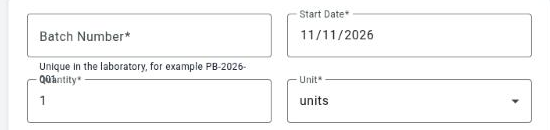

**Recomendación:**

Dar al texto de ayuda el espacio vertical necesario o acortarlo para que quepa en una línea.

#### 6.3.3.2. Evaluación a la aplicación móvil

## 6.4 Video About-The-Product
